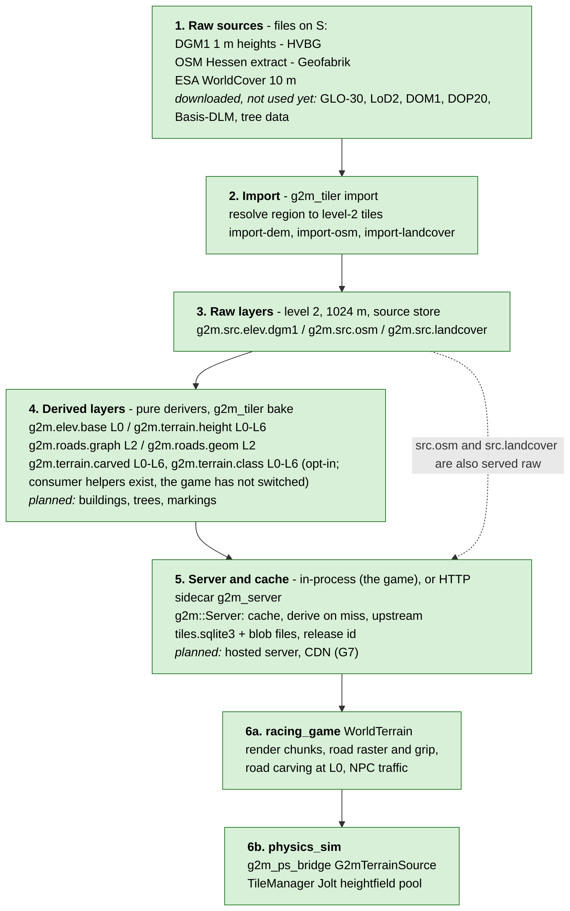
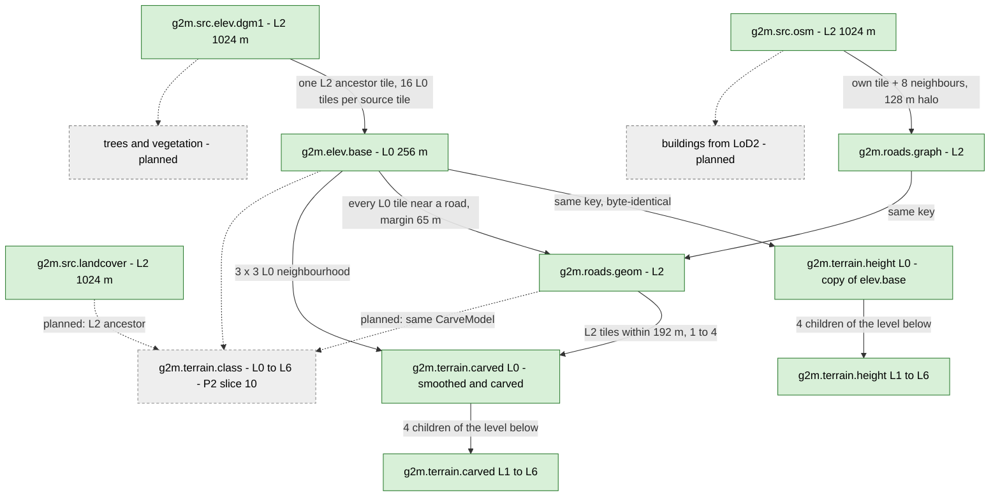
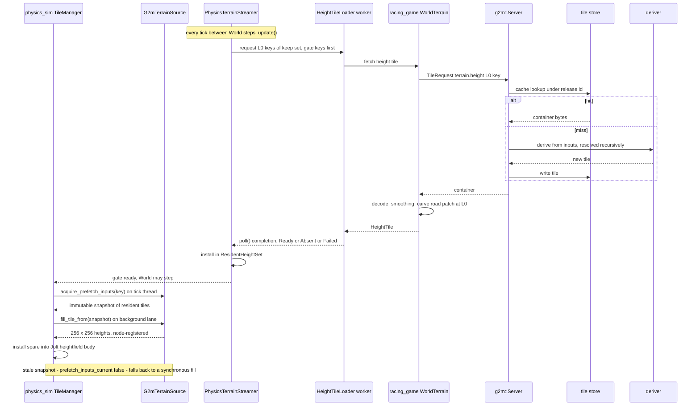
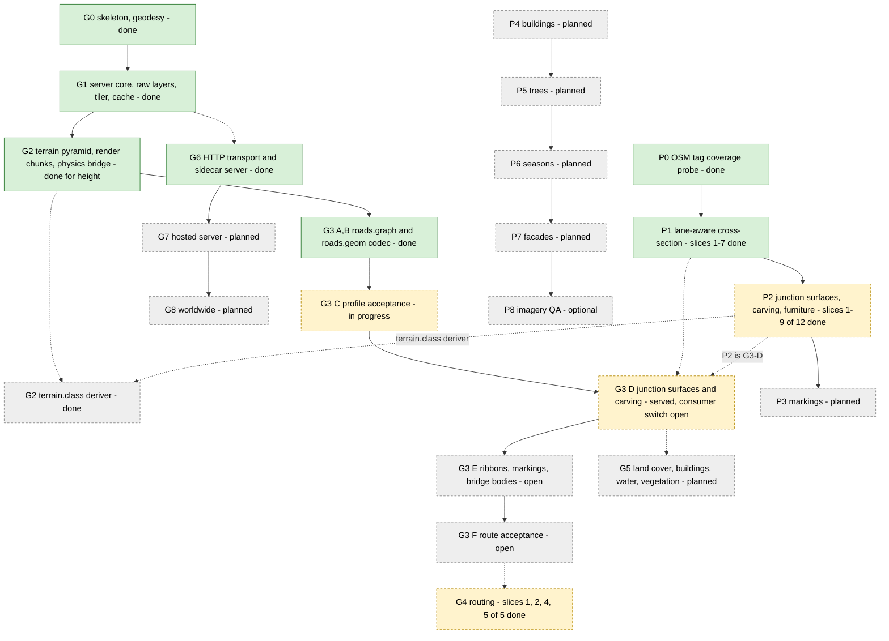

# geo2map pipeline: from raw geodata to a finished map

This is the one entry point. Start here if you have never seen the code.
It shows the whole path with diagrams, then links to the detail pages.

- Status date: 2026-10-05. Verified against the code of `geo2map_engine` master at that date.
- Scope: `geo2map_engine` (this repo) and how its two consumers use it: `racing_game` (render + game) and `physics_sim` (terrain tiles for the physics heightfield). Both consumers are separate repos and are only described here.
- Rule: any change that adds or changes a pipeline stage, layer, encoding, data source or consumer updates this folder in the same commit (also in `CLAUDE.md`).
- Reading the diagrams: **green** = implemented and in use. **amber dashed** = downloaded or designed, not used yet. **grey dashed** = planned. Mermaid renders on GitHub and in most editors.

Contents:

1. [Overview diagram](#1-overview)
2. [Stages, one by one](#2-stages-one-by-one)
3. [Layer dependencies](#3-layer-dependencies)
4. [Runtime: what happens when a tile is requested](#4-runtime-tile-request)
5. [Data sources](#5-data-sources)
6. [Roadmap](#6-roadmap)
7. [How to rebuild and run](#7-how-to-rebuild-and-run)
8. [Glossary](#8-glossary)
9. [Open questions and contradictions](#9-open-questions-and-contradictions)
10. [Index of all other documents](#10-index-of-all-documents)

---

## 1. Overview

The idea in one paragraph. Raw files (a height model, an OSM extract, a land cover raster) are **imported once** into a store of small tiles. Everything else is **derived** from those tiles by pure functions: same input, same bytes, on every machine. A server (in-process today) answers "give me layer X, tile Y" by looking in the cache, deriving the tile if missing, or asking an upstream. The game then turns tiles into render meshes and physics heightfields on its own side.



What the diagram hides, in short:

- **Two height layers.** `g2m.terrain.height` is the plain DGM1 pyramid and stays the default. `g2m.terrain.carved` (street fidelity P2 slice 9, [design](../street_fidelity/p2_junction_design.md) section 6) is the same pyramid with the roads carved in on the server: smoothed DEM, junction and approach cores, blends, deck clearance. No consumer reads it yet: `racing_game` still carves its own copy of the level-0 tile (stage "client derivations" below) until it switches; then its carve step is removed, not kept as a fallback (owner decision 2026-10-05). `g2m.terrain.class` (slice 10, section 2.4) classifies the same points under the same ownership for grip and colour. A `roads.geom` tile that fails to resolve counts as absent for both (G-1): the carved and class tiles are still served, without that tile's roads, and their headers name it with a rejected-input marker.
- **`roads.graph`, `roads.geom` and `terrain.carved` are opt-in.** They are only added to a release when asked for, so the release id of terrain-only releases did not change when they were added. Asking for `terrain.carved` adds both road layers; asking for `terrain.class` adds `terrain.carved` too (a carved-only release keeps its identity, D49).
- **Some things never travel over the wire.** Render meshes, LOD selection, the road colour raster and physics surface ids are computed in the client from tiles.

---

## 2. Stages, one by one

Each stage has: inputs, code, output, versioning, tiling, tests and consumers. Detail pages hold the long text:
[raw layers](raw_layers.md), [terrain](terrain.md), [roads](roads.md), [client side](client_side.md).

### 2.0 Common rules (apply to every stage)

| Rule | Where |
|---|---|
| Layer = name + version + level set + encoding + inputs. Raw layers are imported. Baked layers are made by an `IDeriver`. | `include/g2m/layer/layer_id.h`, `deriver.h` |
| A deriver is a pure function of its input tile bytes and its config hash. No clock, no libm, integer geometry, sorted iteration. | `include/g2m/layer/deriver.h`, `CLAUDE.md` (determinism rules) |
| A tile is a `g2m.tile/1` container: header + body, typed zstd sections, zstd pinned (1.5.7, level 12). | [formats/tile_container.md](../formats/tile_container.md) |
| Tile key: UTM zone + level + x + y. Level L is a square of 256 * 2^L m. Raw layers live at level 2 (1024 m). | `include/g2m/core/tile_key.h`, [formats/README.md](../formats/README.md) |
| A release = a frozen set of tiles and layer versions. Its id is a SHA-256. | [formats/release_manifest.md](../formats/release_manifest.md) |
| Golden hashes must match on Windows and Linux. | `testdata/golden/*.txt`, `tests/golden/` |

### 2.1 Region resolve and import (raw layers)

| | |
|---|---|
| Inputs | A region definition (`g2m.regions/1` JSON, for the home area `racing_game/data/world/regions.json#home`; parts `osm_admin`, `utm_bbox`, `utm_corridor`), one or more OSM PBFs (`--pbf` repeatable), the Hessen DGM1 ZIPs (`--dem-data`) and optionally the Baden-Wuerttemberg DGM1 ZIPs (`--bw-data`), the WorldCover GeoTIFFs. |
| Code | `apps/g2m_tiler/main.cpp` (subcommands `find-admin`, `resolve`, `import-dem`, `import-osm`, `import-landcover`, `import`); `include/g2m/import/{dem,osm,landcover}.h`; decoders in `include/g2m/decode/`. |
| Output | Three raw layers, level 2, in the **source store** (`tiles.sqlite3` + `tiles_blobs/`), scope e.g. `home-2026-09r1`. An `import_report_<scope>.json` is written next to the store. |
| Encodings | `g2m.src.elev.dgm1` body encoding 1 ([src_elev.md](../formats/src_elev.md)); `g2m.src.landcover` encoding 2 ([src_landcover.md](../formats/src_landcover.md)); `g2m.src.osm` encoding 3 ([src_osm.md](../formats/src_osm.md)). |
| Tiling | Level 2 only (1024 m). DGM1: 1024 x 1024 samples per tile, 1/256 m int32, NoData = INT32_MIN. OSM: ways are clipped with a 128 m halo but kept complete. Landcover: 4 m cells, 256 x 256 samples, nearest neighbour. |
| Config hash / release id | Raw tiles are content-addressed (SHA-256 of body). They are the input of the release id. `--pin` marks a scope as a finished release source. |
| Tests | `tests/unit/test_import_*.cpp`, `test_decode_*.cpp`, `tests/layer/test_osm.cpp`, `test_raster_encodings.cpp`, `test_region.cpp`, fuzz targets in `tests/fuzz` and `tests/fuzz_formats`. Goldens: `g1_golden.txt`, `g1c_golden.txt`. |
| Consumers | Every derived layer; `racing_game` also reads `g2m.src.osm` directly for road classes, grip and render colours, and `g2m.src.landcover` for terrain colour and grip. |

Details: [raw_layers.md](raw_layers.md).

### 2.2 Terrain heights: `g2m.elev.base` and `g2m.terrain.height`

| | |
|---|---|
| Inputs | `g2m.src.elev.dgm1` (level 2). |
| Code | `src/layer/derive_terrain.cpp`, `src/layer/terrain_layers.cpp`, `include/g2m/layer/{terrain_layers,derive_terrain,height_tile}.h`. |
| Output | `g2m.elev.base` v1: level 0 only, a direct 256 m window of DGM1 (no resampling). `g2m.terrain.height` v1: levels 0 to 6. Level 0 is byte-identical to `elev.base`. Levels 1 to 6 are the mean of the 4 child tiles of the layer below (half-to-even rounding). Both use body encoding 1. |
| Tile shape | 256 x 256 samples at every level, cell-registered (sample at the cell centre). 1 m cells at level 0, 64 m cells at level 6. |
| Config hash | `ElevBaseDeriver`: `g2m.elev.base/1 dgm1-only`. `TerrainHeightDeriver`: `g2m.terrain.height/2 L0-passthrough-of-elev.base; L1-L6 mean-of-4 half-even pyramid`. The config text is hashed into the release id. |
| Halo | None. Neighbouring tiles are not read. A missing child counts as all-NoData. |
| Tests | `tests/layer/test_derive_terrain.cpp`, `test_terrain_pyramid.cpp`; golden `g2_golden.txt`. |
| Consumers | `racing_game` `WorldTerrain` (render and physics); `g2m_ps_bridge` (physics). |
| Not done | No multi-source blending (GLO-30 etc.) and no halo blending: PLAN.md 6.1 describes more than the code does. The carved heights and `g2m.terrain.class` (street fidelity P2 slices 9-10) are separate layers, section 2.4; `terrain.height` stays the bare default. |

Details: [terrain.md](terrain.md).

### 2.3 Roads: `g2m.roads.graph` and `g2m.roads.geom`

| | |
|---|---|
| Inputs | `roads.graph`: `g2m.src.osm` for the 3 x 3 level-2 neighbourhood. `roads.geom`: the same-tile `roads.graph`, the `roads.graph` tiles that hold every way incident to a node of its ways (stretch context), plus every `g2m.elev.base` level-0 tile the road segments touch (margin 65 m), plus (D57, underpass decks) the `roads.graph` tiles every tile-way segment passes through (crossing context, never stretch context), and (D63) those touching the 61 m square around the first and last node of every tile way, so a covered crossing just past a way boundary is complete for both ways. |
| Code | `src/layer/derive_road_graph.cpp`, `road_graph.cpp`, `road_attributes.cpp`, `osm_roads.cpp`; `derive_road_geom.cpp`, `road_reference.cpp`, `road_profile.cpp`, `vertical_profile.cpp`, `road_dem_dependencies.cpp`, `road_dem_sampler.cpp`; `road_rules.cpp` with `data/road_rules/de.json` (embedded, loader only so far; P2 slice 1 added its `junction` and `furniture` blocks), `carve_params.cpp` with `data/carve/carve_default.json` and `landcover_classifier.cpp` with `data/classifiers/esa_worldcover_v200.json` (embedded, loaders only, no stage uses them yet), `road_surface.cpp` (P2 slice 2: `road_surface_height_m`, pure), `road_junction.cpp` (P2 slices 3-5: `build_node_junction`, `build_road_junctions` with clusters, `junction_height_m`, `adjust_features_for_junctions`, pure), `road_completion.cpp` (P2 slice 6), `road_furniture.cpp` (slice 7), the encoding-7 sections, ownership filter and validation in `road_geom_tile.cpp` (slice 8; encoding 8 since terrain migration phase 4, D47). Builtin wiring: `include/g2m/server/builtin_release.h` (`BuiltinTerrainDerivers::ordered(include_roads, include_geometry)`). |
| Output | `roads.graph` v1, encoding 6 (nodes carry whitelisted tags; the tile also carries the turn restrictions whose via node or via way it holds, G4 slice 3; 5 and 4 still decode; [road_graph.md](../formats/road_graph.md)), level 2. `roads.geom` v1, encoding 8 ([road_geom.md](../formats/road_geom.md); street fidelity P2 slice 8, terrain migration phase 4), level 2: reference line, vertical profile, declined stretches with reasons, plus (street fidelity P1 slice 5) one lane-aware cross-section per profiled stretch (bands, anchor, ramps, offset correction, join records) and a feature section for vertical traffic-calming features (slice 7: carved bumps, humps, tables, dips; lateral kinds render only). Encoding 7 adds the junctions the tile owns (polygons in three ring layers, approaches with trims, raised tables), junction furniture (crossings, stop and give-way lines, signals) and the profile provenance of the completion tier, which the deriver now runs (completed bridge and ground stretches get profiles). Encoding 8 (D47) adds tunnel floors (provenance TunnelFloor: the DEM along the tunnel, or one straight grade between the portals for a stretch of at least de.json's `tunnel.straight_grade_min_length_m`, served 200 m since the owner's ruling, D52; never carved) and the game's accepted-bridge anchors; encoding 7 still decodes. Encoding 9 (D53-D58, the deriver writes it) adds section 8, the underpass decks: the span of a ground stretch over a lower road in a DEM cutting, where the profile follows the rim chord and the game builds a deck; outside it the road stays on the ground. Encoding 6 bodies still decode (no junctions, furniture, provenance), encoding 5 too (no cross-sections). |
| Halo | `roads.graph` uses a 128 m halo and complete ways. An edge belongs to the tile that contains its midpoint (integer mm). `roads.geom` reads DEM tiles up to 65 m outside the road. |
| Config hash | graph: `g2m.roads.graph/1 complete-ways default-RoadStyle halo=128 midpoint-mm-owner raw-nine-neighbours node-tags=1 enc=6 restrictions=1 via-way=1`. geom: `g2m.roads.geom/1 class-policy-2026-10-02 spacing=5 max-samples=2048 iterations=4096 curvature-exceptions=true sloping-plane-r3 approach=32 height-correction=.25 merge-agreement=.5 incline-soft=5 dependency-margin=65 coverage=graph xs=1 enc=9 rules=de:<sha256 of de.json> join-bisector=1 context=nodes junction=1 furniture=1 completion=1 completion-retry=20/16384 completion-abutment=32/200 completion-ground=40/32 strict-anchor=1 ring-nesting=2mm bridge-far-end=1 ground-ease=8/0.05 corner-fillet=1 width-taper=5 tunnel-floor=5/0.29999999999999999/20/chord:200 bridge-anchor-reuse=1 bridge-walk-margin=205 underpass=1 crossing-context=1 underpass-tags=D61 underpass-join=D63/61000` with `enc=9` (`road_geom_config_text()`; the completion values come from `served_road_completion_options()`). The rules hash ties a release id to the exact `data/road_rules/de.json` bytes. |
| Tests | `tests/layer/test_road_*.cpp`, `test_vertical_profile.cpp`; goldens `g2roads_golden.txt`, `g3xs_golden.txt` (served encoding-7 bodies and cross-section boundaries of the two committed OSM fixtures) and `g3j_golden.txt` (their junction, furniture and provenance sections), compared Windows = Linux; `test_road_geom_enc7.cpp` (T7 ownership invariance, T8 one rejection per encoding-7 validation rule); probe `tools/road_probe`. |
| Consumers | `racing_game`: road surface patch (carving into the level-0 height tile), road visuals, bridge structures, NPC traffic and trucks. `g2m.terrain.carved` (section 2.4). |
| Status | Slices A and B of G3 implemented. C has a tested foundation, acceptance open. D to F open. D is designed as street fidelity P2 ([design](../street_fidelity/p2_junction_design.md)); slices 1-7 are library functions (rules, road surface height, junction rings and clusters, junction heights and raised tables, the profile completion tier, junction furniture) and slice 8 serves them: `roads.geom` encoding 7 with junction, furniture and profile-provenance sections, the completion tier on. Slice 9 carves them into `terrain.carved` (section 2.4); slice 10 classifies them into `terrain.class`; the consumer switch is next. See [roads.md](roads.md) and [../g3_road_pipeline.md](../g3_road_pipeline.md). |

### 2.4 Carved terrain: `g2m.terrain.carved`

| | |
|---|---|
| Inputs | Level 0: the 3 x 3 `g2m.elev.base` neighbourhood of the tile (absent = NoData; an absent centre is NotFound) and every `g2m.roads.geom` level-2 tile intersecting the tile grown by 192 m (one typically, at most four; absent = no roads). Levels 1-6: the 4 same-layer children. |
| Code | `src/layer/terrain_carve.cpp`, `include/g2m/layer/terrain_carve.h` (`CarveTerrain`, `CarveModel`, `carve_terrain_tile`, `carve_road_geom_keys`, `TerrainCarvedDeriver`); parameters `data/carve/carve_default.json` via `carve_params.cpp`; surfaces from `road_surface.cpp` and `road_junction.cpp` (`junction_height_m`). Builtin wiring: `BuiltinTerrainDerivers::ordered(include_roads, include_geometry, include_carved)`. |
| Output | `g2m.terrain.carved` v1, levels 0-6, body encoding 1 like `terrain.height` ([terrain_carved.md](../formats/terrain_carved.md)). Level 0 per cell (centre E + 0.5, N + 0.5): the DEM smoothed by the game's kernel as integers; junction cores (Shepard junction surface, D42: the blend mixes the approach bases, each approach's crown and verge relief fades out from its trim over 3-15 m and 1.5 m) beat approach cores, the lowest core wins; else the blend (3-15 m, widened to 1:1.5) of largest weight, ties to the lowest z; then the deck clearance clamp (0.55 m under bridges, ramped over 4 m from each end); `round_half_even(z * 256)`. Bridges and tunnels are never carved, `OnStructure` junctions neither. Levels 1-6: mean-of-4 half-even of the carved level below. |
| Config hash | `g2m.terrain.carved/1 smooth+carve L0 roads.geom enc=9 radius=192 junction=D42 underpass-deck=1 underpass-walls=steep/1 carve=<sha256 of carve_default.json>; L1-L6 mean-of-4 half-even` (`terrain_carved_config_text()`). |
| Halo | No shared samples: every cell is a function of its world position, so neighbouring tiles agree at their edge (tested across L0 and L2 seams). DEM reads (smoothing, blend widths) stay inside the 3 x 3 window; a junction blend knot whose DEM point falls outside it uses the class width and is counted (0 on the fixtures). |
| Cost | 0.2-0.45 s per level-0 tile on 1 worker on the fixtures (about 0.1 s of it serial: smoothing and model build), against a copy for `terrain.height` L0; numbers in the design's slice 9 record. |
| Rejected input (G-1) | A `roads.geom` input whose resolution fails with an error (e.g. utm32n/2/452/5428, rejected by its own validation: "reference endpoints") is treated like an absent one: no roads from it, the tile is Found, and the header lists `rejected_input_marker(ref)` in its inputs (`IDeriver::rejected_input_is_absent`, `server.cpp`). Errors are not cached, so each dependent request derives the failing tile again. A failing `elev.base` input still fails the tile. |
| Tests | `tests/layer/test_terrain_carve.cpp` (T12-T15, T17, T19, tile invariance, smoothing parity, grade limits, served path, G-1 rejected roads.geom with a strict negative control); `test_junction_gradient.cpp` (D42: junction gradient within the bound its trim data allow, flat and tilted DEM); golden `g3d_golden.txt`, Windows = Linux. |
| Consumers | None yet. `racing_game` switches to it (request `g2m.terrain.carved` L0-L6 instead of `g2m.terrain.height`, no fallback) and deletes its own carving: [P2 design section 10](../street_fidelity/p2_junction_design.md#10-consumer-switch-what-racing_game-needs-and-deletes). |
| Not done | The game switch to the served layers (the render class window from `terrain.class` exists since slice 11 / D62, `chunk_terrain_classes.h`); home-region measurement (slice 12; the G-6 underpass census exists as `road_underpass_census` and `g2m_road_probe --underpasses`, not yet run on the home store). |

**`g2m.terrain.class`** (slice 10, terrain migration phase 6; [terrain_class.md](../formats/terrain_class.md)): 257 x 257 nodes at integer metres (both edges; level 0 = the physics cell centres), four u8 planes land_class, surface, role, rank. Level 0 runs the carve's `CarveModel::evaluate` and `classify` at every node (road bed / sidewalk / verge by the served footprint bands, junction rings, blends, bridge footprints) and takes the `g2m.src.landcover` class through the embedded ESA classifier where no road owns the node; levels 1-6 keep the highest-rank sample of each 3 x 3 neighbourhood (ties to the centre, then row-major). Inputs (D49): level 0 = the carved inputs + the land cover level-2 tiles holding any of its nodes; level L = the 4 x 4 same-layer tiles of level L-1. Header datum None. Code `include/g2m/layer/terrain_class.h`, `src/layer/terrain_class.cpp`; opt-in `BuiltinTerrainDerivers::ordered(..., include_classes)`, `bake --layers g2m.terrain.class`, `LayerOptIn{classes}` of `TerrainService`. Tests `tests/layer/test_terrain_class.cpp` (encoding, T16 with the cell-centre negative control, L0 and L2 seam equality with the D49 ancestor-only control, T17 rank-max vs a brute-force reference, served path), golden `g3c_golden.txt`, fuzz target `terrainClass`. Physics class mode (requests G-2/G-5): `TransportHeightTileFetch(transport, rid, g2m.terrain.carved, g2m.terrain.class)` fetches both, `LoaderConfig::require_classes`, `ResidentHeightSet` keeps the class tile beside the heights and the RoadSegment metadata, `fill_physics_classes` resolves every cell centre through the full `SurfaceIdTable`, and `G2mTerrainSource(grid, resident, ClassSurfaceConfig{table, fallback})` fills with it and supports the Snapshot prefetch (class tile identity compared). Render (slice 11, D62): `TerrainService::terrain_class(key)` hands out the decoded tile; `g2m::world::fill_chunk_terrain_classes` builds a chunk's `ClassWindow` from the class tile of the chunk's level (the vertex at (64 cx + i) 2^L + 0.5 m takes its south-west node, road nodes filtered by the caller's `RenderRoadLod` on the rank plane), and `ViewSource::terrain_classes` makes the view streamer use it instead of the OSM road raster.

### 2.5 Client-side derivations (not served)

| What | Where | Note |
|---|---|---|
| Render chunk mesh (65 x 65 vertices from a 67 x 67 halo window, same triangle diagonal as Jolt) | `include/g2m/mesh/terrain_chunk.h`, `src/mesh/terrain_chunk.cpp` | Bit-identical across chunk borders (test). |
| LOD quadtree selection | `include/g2m/mesh/lod_select.h` | |
| OSM road raster (colour) and per-cell road surface ids (grip) | `include/g2m/layer/osm_roads.h`: `extract_road_segments`, `rasterize_road_segments`, `paint_road_segments`, `RoadStyle` table; goldens `g2roads`, `g2paint` | Colour and grip come from `g2m.src.osm` (+ `g2m.src.landcover` for the base class), not from a baked layer. |
| Physics tile fill (255 m tiles, 256 samples, node-registered, anchored on DGM1 cell centres by integer offset copy) | `include/g2m/phys/fill_physics_heights.h` | No interpolation. |
| Physics surface ids per cell | `include/g2m/phys/fill_physics_surfaces.h` (road mode), `fill_physics_classes.h` (class mode, from `g2m.terrain.class`) | |
| Residency, gate, prefetch, look-ahead | `include/g2m/phys/{resident_heights,height_tile_loader,physics_streamer}.h` | |
| Engine-neutral consumer helpers (`g2m_world`, terrain migration phase 1, vault G2M-020): container decode with `height_offset`, double-checked fetch caches for height tiles and `g2m.src.osm` road segments, two point height samplers (`sample_height_exact` = the Jolt/render triangulation, `sample_height_bilinear` = render only), per-chunk OSM road classes (owner rule), `SurfaceIdTable` | `include/g2m/world/{tile_fetch,height_sampler,chunk_road_classes,surface_id_table}.h`, `src/world/` | Ported bit for bit from `racing_game/core/src/world_terrain.cpp`, `route_check.cpp`, `road_classes.cpp` (pinned in `tests/world/`); the game and the physics bridge switch in the next phases. No change to any layer or release id. Phase 2 adds `TerrainService` (`include/g2m/world/terrain_service.h`, `ticket.h`, `products.h`; `src/world/terrain_service.cpp`, `job_scheduler.cpp`): stores, layer opt-ins, in-process server and one priority worker pool behind `Ticket<T>` requests, per-tile derive-once dedup (also inside the server resolver), `warm()` and `physics_fetch()`; details in [client_side.md](client_side.md). The server resolver (`server.h`) deduplicates concurrent resolutions of one (release, layer, key). |
| Road carving into a copy of the level-0 height tile | `racing_game/core/src/world_terrain.cpp` (`fetch_and_decode`) | Stays in the game until it switches to the served `g2m.terrain.carved` (section 2.4, available since P2 slice 9); then the game step is removed, not kept as a fallback (owner decision 2026-10-05). The full delete list (smoothing, `RoadSurfacePatch`, deck clearance cut, `complete_road_profiles` and its retry, the src.osm grip and colour raster, junction fades) and the switch gate are in [P2 design section 10](../street_fidelity/p2_junction_design.md#10-consumer-switch-what-racing_game-needs-and-deletes). |

Details: [client_side.md](client_side.md).

### 2.6 Server, cache, releases

| | |
|---|---|
| Code | `include/g2m/server/{server,builtin_release,protocol,tile_store}.h`, `src/server/*.cpp`, `include/g2m/client/{cache,in_process_transport}.h`; HTTP (G6): `include/g2m/http/{http_wire,http_transport,http_server}.h`, `src/http/`, `apps/g2m_server/`. |
| Behaviour | `Server::handle()` routes a protocol v1 request. Resolver chain per layer: Cache (derived store under the release id), Derive (inputs resolved recursively), Upstream (local source store, later network). Results of Derive are written to the derived store. |
| Store | SQLite + blob files, content-addressed: [formats/cache_db.md](../formats/cache_db.md). |
| Release | Release id = SHA-256 over source tile hashes, layer versions and config hashes, classifiers and the world seed: [formats/release_manifest.md](../formats/release_manifest.md). Manifest `g2m.release/1`; server manifest `g2m.server/1` in [formats/protocol.md](../formats/protocol.md). |
| Status | In-process in the game. G6: protocol v1 over HTTP (`g2m_http`: `HttpTransport` = an `ITransport` client, `HttpServer` = a front end for any `ITransport`; binding in [../protocol/README.md](../protocol/README.md)) and the sidecar `apps/g2m_server` (one local release over a read-only source store, offline by construction, 127.0.0.1 by default; same release id as the in-process server for the same store and opt-ins). Not wired into racing_game. No served byte or release id changed. `g2m_cli` does not exist yet. Offline mode returns 503 degraded instead of touching the network. |
| Tests | `tests/server/test_server.cpp`, `test_tile_store.cpp`, `test_protocol.cpp`, `test_client_cache.cpp`, `tests/layer/test_release.cpp`, `test_pack.cpp`; `tests/http/test_http_wire.cpp`, `test_http_server.cpp` (`g2m_http_tests`: HTTP vs in-process byte-identical round trip of every endpoint and status, status mapping, malformed requests, concurrency); fuzz targets `packDirectory`, `httpRequest`, `httpResponse`. |

---

## 3. Layer dependencies

Which tile of which layer is needed to build a tile of another layer. The labels carry the halo and neighbour rules.



Tile-level rules worth remembering:

- `elev.base` has **no halo**. Two neighbouring tiles share no samples. Seams are handled by the consumers (render halo window, physics edge weld).
- The terrain pyramid needs all four children even for a tile at the data edge. A missing child counts as NoData, never as an error.
- `roads.geom` is the only built-in layer whose input list depends on the data (`additional_inputs_for`), in two discovery stages (D35): stage 1 names the DEM tiles under the complete ways and the `roads.graph` tiles holding every way incident to their nodes; stage 2, once those are resolved, names the DEM along every bridge incident to those nodes (65 m margin) and the `roads.graph` tiles of its nodes, so the far end of a bridge span is always an input, and (D48) the elev.base and `roads.graph` tiles of a 205 m square around every node of those bridges, which bound the 200 m abutment walk. Stage 1 also names (D57) the `roads.graph` tiles every segment of a tile way passes through, so every road crossing a tile way without a shared node (an underpass) is complete in the crossing graph, and (D63) the `roads.graph` tiles of a 61 m square around the end nodes of every tile way, which bound the way-boundary support of a covered crossing. Other derivers use one stage.
- A `terrain.carved` L0 tile (and a `terrain.class` L0 tile, which also reads the land cover level-2 tiles holding its 257 x 257 nodes) reads its own and its 8 neighbouring `elev.base` tiles and every `roads.geom` tile within 192 m (one typically, at most four). Each junction is stored only in the `roads.geom` tile holding its smallest node id; the 192 m radius is what makes that sufficient ([design section 5](../street_fidelity/p2_junction_design.md#5-tile-invariance)).
- A tile in the 1 km halo of the region may have no DGM1 coverage: 85 such tiles were skipped at import (`import_report_home-2026-09r1.json`).

---

## 4. Runtime tile request

What happens when the game needs a terrain tile. This is the physics path with prefetch. The render path is the same up to "decode"; it then builds a chunk mesh instead.



Notes:

- The tick-time path never calls the server. Only the loader workers do.
- The gate (clock freeze) is a function of position and radius only. Velocity and timing never change which tiles are required, so the simulation stays deterministic.
- Render chunks use the same decoded tile from `WorldTerrain::height_tile()` (cached, mutex-guarded), then `gather_window` and `build_chunk`.
- Code: `include/g2m/phys/physics_streamer.h` (the header comment documents the order), `bridges/physics_sim/include/g2m/ps_bridge/g2m_terrain_source.h`, `racing_game/core/src/world_terrain.cpp`, `physics_sim` `core/src/terrain/tile_manager.cpp` (prefetch tickets). Test: `bridges/physics_sim/tests/test_prefetch_snapshot.cpp`.

---

## 5. Data sources

Files are under `S:\claude_code\geo2map_data\downloads\` (not in git). The full licence and URL text is in `S:\claude_code\geo2map_data\SOURCES.md`; this table is the summary. "Used" means a pipeline stage reads it today.

| Dataset | Provider | Licence | Attribution duty | Local path | Stage | Status |
|---|---|---|---|---|---|---|
| DGM1, 1 m terrain heights | HVBG Hessen | dl-de/zero-2.0 | Optional (we keep it) | `downloads/dgm1/PKT_*.zip` (8 files, 8.5 GB) | `import-dem` -> `g2m.src.elev.dgm1` | **Used** |
| DGM1, 1 m terrain heights (Mannheim/Viernheim strip) | LGL Baden-Wuerttemberg | dl-de/by-2.0 | **Required**: "Datenquelle: LGL, www.lgl-bw.de" | `downloads/lgl_bw_dgm1/dgm1_32_*_2_bw.zip` (59 files) | `import-dem --bw-data` -> `g2m.src.elev.dgm1` (merged with Hessen at the border) | **Used** (corridor region) |
| OSM Regierungsbezirk Karlsruhe extract | Geofabrik / OpenStreetMap | ODbL 1.0 | **Required** | `downloads/karlsruhe-regbez-latest.osm.pbf` | `import-osm` (second `--pbf`), merged with the Hessen extract | **Used** (corridor region) |
| OSM Hessen extract | Geofabrik / OpenStreetMap | ODbL 1.0 | **Required**: (c) OpenStreetMap contributors; share-alike for derived databases (affects served packs, G7) | `downloads/hessen-latest.osm.pbf` | `import-osm` -> `g2m.src.osm`; roads, grip, colours | **Used** |
| ESA WorldCover 2021 v200 | ESA | CC BY 4.0 | **Required** | `downloads/ESA_WorldCover_10m_2021_v200_N48E006_Map.tif` | `import-landcover` -> `g2m.src.landcover` | **Used** |
| Copernicus GLO-30 DEM tiles N49 and N50 | Copernicus / ESA | Copernicus DEM licence | **Required** (DLR, Airbus, EU, ESA text in SOURCES.md) | `downloads/Copernicus_DSM_COG_10_N49_00_E008_00_DEM.tif`, `..._N50_...` | Planned fallback for DGM1 gaps | Downloaded, not used |
| HVBG LoD2 3D buildings | HVBG | **dl-de/by-2.0** | **Required** (HVBG source line, SOURCES.md) | `downloads/hvbg_lod2/` (1.2 GB) | Planned: buildings (street fidelity P4) | Downloaded, not used |
| HVBG DOM1 surface model | HVBG | dl-de/zero-2.0 | Optional | `downloads/hvbg_dom1/` (4.2 GB) | Planned: trees (P5) | Downloaded, not used |
| HVBG DOP20 orthophotos | HVBG | dl-de/zero-2.0 | Optional | `downloads/hvbg_dop20/` (4.8 GB) | Planned: colours, QA (P5, P6) | Downloaded, not used |
| ATKIS Basis-DLM Hessen | HVBG | dl-de/zero-2.0 | Optional | `downloads/hvbg_basis_dlm/` (298 MB) | Planned: road width, lanes (P1) | Downloaded, not used |
| Frankfurt Baumkataster | Stadt Frankfurt | dl-de/by-2.0 | **Required** | `downloads/frankfurt_baumkataster/` | Planned: trees (P5) | Downloaded, not used |
| Thuenen dominant tree species | Thuenen Institute | CC BY 4.0 | **Required** (citation with DOI in SOURCES.md) | `downloads/thuenen_tree_species/` | Planned: trees (P5, P6) | Downloaded, not used |
| Copernicus HRL tree cover and leaf type | Copernicus Land Monitoring Service / EEA | Free and open (Regulation (EU) 1159/2013) | **Required** (EU, Copernicus, EEA) | `downloads/copernicus_hrl/` | Planned: trees (P5) | Downloaded, not used |
| DWD phenology | Deutscher Wetterdienst | GeoNutzV | **Required**: source reference | `downloads/dwd_phenology/` | Planned: seasons (P6) | Downloaded, not used |

Attribution status in the game: the `racing_game` manifest lists only the DGM1 attribution today. OSM, WorldCover and the others are not in a credits screen yet (R5 is not done). See [open questions](#9-open-questions-and-contradictions).

---

## 6. Roadmap

Two plans meet here: the engine phases G0 to G8 (in `racing_game/PLAN.md` section 12 and `PLAN.md` here) and the street fidelity phases P0 to P8 ([../street_fidelity/plan.md](../street_fidelity/plan.md)).



| Item | Status | Where it is described |
|---|---|---|
| Terrain pyramid, render chunks, physics bridge, prefetch ring | Implemented | [terrain.md](terrain.md), `racing_game/PLAN.md` G2/R2 |
| `terrain.carved` deriver | Implemented (street fidelity P2 slice 9), opt-in, no consumer yet | section 2.4, [../street_fidelity/p2_junction_design.md](../street_fidelity/p2_junction_design.md) section 6 |
| `terrain.class` deriver | Implemented (street fidelity P2 slice 10, terrain migration phase 6), opt-in, no consumer yet; physics class mode in `g2m_phys` and the bridge | section 2.4, [../formats/terrain_class.md](../formats/terrain_class.md), [../street_fidelity/p2_junction_design.md](../street_fidelity/p2_junction_design.md) section 6.5 |
| G3 A: identity-preserving graph | Implemented | [../g3_road_pipeline.md](../g3_road_pipeline.md) |
| G3 B: graph and geom tile encoding, derivation, opt-in serving | Implemented | [../g3_road_pipeline.md](../g3_road_pipeline.md), [../formats/road_geom.md](../formats/road_geom.md) |
| G3 C: reference lines and vertical profiles | Foundation implemented, acceptance open | [../g3_profile_foundation.md](../g3_profile_foundation.md), [../g3_reference_lines.md](../g3_reference_lines.md) |
| G3 D: junction surfaces and server-side carving | In progress as street fidelity P2: junction surfaces served (slice 8), carved heights served (slice 9), terrain.class served and the physics class mode wired (slices 10-11, terrain migration phase 6; the render class window D62); the home census and the game switch open | [../g3_road_pipeline.md](../g3_road_pipeline.md) section D, [../street_fidelity/p2_junction_design.md](../street_fidelity/p2_junction_design.md) |
| G3 E: ribbons, markings, bridge bodies | Open | section E |
| G3 F: route acceptance | Open | section F |
| Street fidelity P0 (tag probe) | Done | [../osm_tag_coverage_home.md](../osm_tag_coverage_home.md) |
| Street fidelity P1 (lane-aware cross-section) | Slices 1 to 7 implemented (context, node tags, base and join resolution, encoding 6, consumer API: carve footprint, lane queries, grip-raster envelope, carved profile features) | [../street_fidelity/p1_cross_section_design.md](../street_fidelity/p1_cross_section_design.md) |
| Street fidelity P2 (junction surfaces, carving, furniture = G3-D) | Slices 1-9 of 12 done: rules, surface height, junction rings and clusters, junction heights, the completion tier and furniture as library functions, served since slice 8 in `roads.geom` encoding 7 (junctions, furniture, provenance); slice 9 serves the carved heights `g2m.terrain.carved`; slice 10 serves `g2m.terrain.class`, slice 11 wires the physics class mode and the render class window (D62), slice 12's G-6 underpass census exists and underpass decks are served (roads.geom encoding 9, D53-D58), home run open; both owner questions answered 2026-10-05 (switch gate not zero gaps, relaxed profiles served flagged) | [../street_fidelity/p2_junction_design.md](../street_fidelity/p2_junction_design.md) |
| Street fidelity P3 to P8 | Planned, nothing written | [../street_fidelity/plan.md](../street_fidelity/plan.md) section 6 |
| G4: routing, guidance, map geometry | Slices 1-2 implemented (routable graph, edge-based A* with ALT, oneway, via-node restrictions, heading-aware snapping, region graph from roads.graph tiles; `g2m_route`), slice 4 (guidance manoeuvre list, with lane hints from `turn:lanes`) and slice 5 (client map tiles at three LODs); slice 3 turn restrictions in `roads.graph` encoding 6 and via-way rules in the search | [../routing_design.md](../routing_design.md) |
| G6: protocol v1 over HTTP, sidecar `g2m_server` | Implemented (plain HTTP, localhost by default; not wired into racing_game) | [../protocol/README.md](../protocol/README.md), [../formats/protocol.md](../formats/protocol.md), [../formats/pack.md](../formats/pack.md) |
| G7: hosted server (TLS, auth, rate limits, upstream chaining, CDN) | Planned; prerequisites listed in [../protocol/README.md](../protocol/README.md) "Not in G6" | `PLAN.md` |

---

## 7. How to rebuild and run

Only commands that exist in the code as of this date. Run from `S:\claude_code\geo2map_engine` in a VS 2022 developer shell (`tools\ci.ps1` enters one itself).

### 7.1 Build and test the library

```powershell
cmake --preset release
cmake --build --preset release
ctest --preset release --output-on-failure
```

CI (see `tools/ci.ps1` header and `CLAUDE.md` for the exact legs):

```powershell
tools\ci.ps1                 # default fast run
tools\ci.ps1 -Full           # every leg, every test
```

There is no docs-only mode in `tools/ci.ps1`. A docs-only change needs no build.

### 7.2 Import raw data into a store

The tiler is built by default (`G2M_BUILD_APPS` is ON). All subcommands are in `apps/g2m_tiler/main.cpp` (`usage()`).

```powershell
g2m_tiler resolve regions.json#home --pbf hessen-latest.osm.pbf --out home.resolved.json
g2m_tiler import regions.json#home --pbf hessen-latest.osm.pbf --store STORE_DIR --scope SCOPE `
    --dem-data DGM1_DIR --wc-data WORLDCOVER_DIR --jobs N --pin
g2m_tiler stats --store STORE_DIR --scope SCOPE
g2m_tiler index-hash --store STORE_DIR --scope SCOPE
```

`import` runs resolve + `import-dem` + `import-osm` + `import-landcover` and writes `import_report_<scope>.json`. `--pbf` may be given several times and `--bw-data DIR` adds the Baden-Wuerttemberg DEM (see [raw_layers.md](raw_layers.md) "Two DEM sources"); `--dem-data` becomes optional when `--bw-data` is given. The individual `import-*` subcommands take `--resolved` instead of the region argument. `diff-scopes` compares two stores tile by tile. `check-dem-nodata` reports DEM tiles with no data. The real home import (scope `home-2026-09r1`) took 131 s and wrote 3170 tiles (807 MB) per its report.

### 7.3 Bake derived layers

```powershell
g2m_tiler bake --store STORE_DIR --scope SCOPE --derived DERIVED_DIR `
    --layers g2m.elev.base,g2m.terrain.height [--levels 0-6] [--jobs N] [--pin]
```

`--store` must be a finished, `--pin`ned scope. The result does not depend on `--jobs`. Without `bake`, a consumer derives tiles on demand through `g2m::Server` into its own derived store (`racing_game` does this for the home region, store `S:\claude_code\geo2map_cache\home-r1\baked`). Levels a layer does not have are skipped (`roads.*` exist only at level 2). Naming `g2m.roads.graph` in `--layers` adds the road graph deriver to the release; naming `g2m.roads.geom` adds both; naming `g2m.terrain.carved` adds the carved deriver and both road derivers; naming `g2m.terrain.class` adds the class deriver and everything carved needs (`src/import/bake.cpp`: `include_roads` / `include_geometry` / `include_carved` / `include_classes`). Adding them changes the release id; terrain-only bakes keep the old one.

### 7.4 Probes

```powershell
g2m_osm_tag_probe --pbf F --region REGIONS.json#NAME --out-md F --out-json F
g2m_road_probe STORE_DIR SCOPE utm32n/2/455/5421 out.csv [--exceptions] [--profiles]
```

Both are under `G2M_BUILD_APPS`. See `tools/osm_tag_probe` and `tools/road_probe/README.md`. The probes never write to the tile cache.

### 7.5 Use it from the game

`racing_game` reads `data/world/world_config.json`: source store `${RG_G2M_HOME}` (default `S:\claude_code\geo2map_cache\home-r1`), scope `home-2026-09r1`, derived store `${RG_G2M_HOME}/baked`. Nothing in that repo bakes it. See `racing_game/CLAUDE.md` section "World config".

### 7.6 Where the release id changes

Any change to a deriver's config text, a layer version, an encoding version, a classifier or a source tile changes the release id. That is by design: a new id means new derived tiles. Changing only docs or tests does not.

---

## 8. Glossary

| Term | Meaning |
|---|---|
| Layer | A named, versioned set of tiles, e.g. `g2m.terrain.height`. Raw (imported) or baked (derived). |
| Raw layer | Imported from a source file. Names start with `g2m.src.`. Level 2. |
| Baked layer | Made by a pure deterministic deriver from other layers. |
| Deriver (`IDeriver`) | A pure function: input tiles + config -> output tile bytes. |
| Tile | One cell of a layer, stored as a `g2m.tile/1` container. |
| Tile key | `utm<zone>n/<level>/<x>/<y>`. Packed into 64 bits for storage. |
| Tile level | Level L covers 256 * 2^L metres per side. Level 0 = 256 m, level 2 = 1024 m, level 6 = 16384 m. |
| Cell-registered | A sample sits at the centre of its cell (half-metre offsets for 1 m cells). Used by render and the stored height tiles. |
| Node-registered | A sample sits on a lattice corner. Used by the physics heightfield tiles (255 m, 256 samples). |
| Halo | Extra data around a tile that is read but not owned, so neighbours agree. `roads.graph`: 128 m. Render chunk: a 67 x 67 window around 65 x 65 vertices. |
| Stretch | A section of one road between two junctions or structure boundaries. The unit of horizontal and vertical fitting in `roads.geom`. |
| Reference line | The fitted horizontal centre line of a stretch (straights, clothoids, arcs). |
| Profile | The vertical line of a road: height along the reference line, bounded by class grade and curvature. |
| Complete way | An OSM way with all its nodes, even outside the tile. Needed so a profile never fits a clipped fragment. |
| Declined stretch | A stretch the fitter refused, kept in `roads.geom` with an explicit reason. |
| Encoding | The byte format of a tile body (1 elev, 2 landcover, 3 osm, 4 road graph, 5 road geom). |
| Config hash | SHA-256 of a deriver's own config text. Part of the release id. |
| Release | A frozen, named set of layers and source tiles that the server serves. |
| Release id (rid) | SHA-256 over source tile hashes, layer versions and config hashes, classifiers, world seed. |
| Scope | A name for one import into a store, e.g. `home-2026-09r1`. |
| Source store / derived store | The imported raw tiles / the cache of derived tiles. |
| Pin | Marks a scope as finished and protected from eviction. |
| Resolve | Turn a region definition into a list of level-2 tiles (interior runs + halo). |
| Resolver chain | Cache, then Derive, then Upstream, inside `g2m::Server`. |
| Gate | The set of physics tiles that must be resident before the simulation clock may advance. |
| Prefetch ring | Extra tiles loaded around the gate set, plus a look-ahead square along the velocity. |
| Snapshot input | An immutable copy of resident tiles that a background thread uses to fill a physics tile. |
| Golden hash | A recorded hash of an encoder or deriver output. Must equal on Windows and Linux. |
| NoData | `INT32_MIN` in height tiles. |
| Datum | Vertical reference: DHHN2016 normal heights for DGM1. |
| Street fidelity P0 to P8 | The phased plan for lane, marking, building and tree detail. |

---

## 9. Open questions and contradictions

These are listed, not resolved. Each needs an owner decision or a check.

1. **G3 endpoint heights vs class grade.** [../g3_road_pipeline.md](../g3_road_pipeline.md) (checkpoint, top) says the priority between endpoint heights and class grade "needs an owner choice". [../g3_profile_foundation.md](../g3_profile_foundation.md) says endpoint heights and class bounds "retain priority". `racing_game/PLAN.md` G3 status says the grade-policy question "is withdrawn" (it came from reading an underpass as a deck slope). The geo2map docs still show it pending. **Resolved 2026-10-05 (owner):** measured endpoint heights win. Where honouring them needs a grade steeper than the class bound, the profile keeps the endpoint heights and the stretch is flagged as a grade exception (the existing exception mechanism), not clamped. [../g3_road_pipeline.md](../g3_road_pipeline.md) and [../g3_profile_foundation.md](../g3_profile_foundation.md) say so now; the `racing_game` note about a withdrawn question stays true for the underpass case.
2. **HVBG LoD2 licence.** `geo2map_data/SOURCES.md` records dl-de/**by**-2.0 (attribution required) after reading the primary metadata. [../street_fidelity/plan.md](../street_fidelity/plan.md) and `PLAN.md` 3.9, 5.3 and 13 plan with dl-de/**zero**-2.0 for HVBG products. **Resolved 2026-10-05 (documents):** `street_fidelity/plan.md` and `PLAN.md` 3.9, 5.3 and 13 now plan with dl-de/by-2.0 and attribution for LoD2; the attribution list must include it before buildings ship.
3. **Attribution is not shown to players.** `racing_game`'s manifest lists only the DGM1 attribution. OSM (ODbL), WorldCover (CC BY 4.0) and Copernicus are in use or downloaded, but the credits screen (R5) is not built.
4. **Where road carving lives.** Today `racing_game` carves a road patch into the level-0 height tile after decode. The roadmap (G3-D) says the server derives carved heights and `terrain.class` from the same geometry. Until G3-D, two consumers that skip the game's step would see uncarved terrain. **Resolved 2026-10-05 (owner):** carving stays in `racing_game` (`WorldTerrain::fetch_and_decode`, level 0) until G3-D ships server-side carved heights. When G3-D lands, the game consumes the server's carved heights and its own carve step is REMOVED, not kept as a fallback: one source of truth for render and physics (same principle as the G2M-010 grip rule). The P2 design ([section 10](../street_fidelity/p2_junction_design.md#10-consumer-switch-what-racing_game-needs-and-deletes)) lists what the game needs and deletes. Status: the server layer `g2m.terrain.carved` exists since P2 slice 9 (section 2.4); the game has not switched yet. It also moves the game's profile completion to the server. Owner question Q1 is answered (2026-10-05): work-in-progress states are acceptable, so the switch does not wait for zero uncarved stretches; the census lists the remaining ones.
5. **`CLAUDE.md` of this repo is partly stale.** It still describes `elev.base`, `terrain.height`, `bake`, roads and the road probe as not built or planned in places. This docs folder is checked against code; `CLAUDE.md` should be reconciled.
6. **PLAN.md vs code, terrain.** PLAN.md 6.1 describes multi-source blending and a 16 m halo for `elev.base`. The code is DGM1-only without halo. (`g2m.terrain.class` has its deriver since P2 slice 10.)
7. **PLAN.md vs code, CLI.** PLAN.md 3.10 and 5.5 describe a CLI that differs from the real `g2m_tiler` subcommands. `apps/g2m_server` and `g2m_cli` are not built.
8. **`LayerEncoding` enum.** Resolved 2026-10-05: the enum now lists the road encodings (`RoadGraph` 4, `RoadGraphNodeTags` 5, `RoadGeom` 5, `RoadGeomCrossSection` 6). Ids are per layer, so the same number can name two layers' encodings.
9. **Height quantiser unification (Q3).** PLAN.md records it as undecided: the half-even quantiser (DGM1 importer) and the older ties-away-from-zero `quantise_height` (everything else) both exist.
10. **85 DGM1 halo tiles without coverage.** Accepted until the GLO-30 fallback exists. Heights there are NoData.
11. **Pin values differ between documents.** `bridges/physics_sim/physics_sim.pin` holds `b90a531...`; older PLAN text mentions `5c648a5` and `be36545`; `racing_game` pins other commits. Which is the supported combination? Check `git submodule status` in `racing_game`.
12. **Is roads baked for the home store?** `bake` accepts the road layers (code verified), but this review did not run it and did not check whether `S:\claude_code\geo2map_cache\home-r1\baked` already holds `roads.*` tiles.
13. **Street fidelity plan is partly outdated.** Resolved 2026-10-05: its section 9 now says what has been downloaded. Since 2026-10-05 LoD2, DOM1, DOP20, Basis-DLM, tree datasets, HRL and phenology are downloaded ([section 5](#5-data-sources)).
14. **Road curvature exceptions: decided or not?** `tools/road_probe/README.md` says the owner must choose how served geometry represents curvature exceptions. [../g3_reference_lines.md](../g3_reference_lines.md) says the owner continuation selects "preservation with explicit curvature exceptions", and the `roads.geom` config hash text contains `curvature-exceptions=true`. The probe README reads as undecided, the other two as decided.
15. **Stale bake flags in a format doc.** Resolved 2026-10-05: road_graph.md and g3_road_pipeline.md now say `--levels 2-2` (the real tiler flag, `apps/g2m_tiler/main.cpp`).

---

## 10. Index of all documents

| Topic | Document |
|---|---|
| This overview | `docs/pipeline/README.md` |
| Detail pages | [raw_layers.md](raw_layers.md), [terrain.md](terrain.md), [roads.md](roads.md), [client_side.md](client_side.md) |
| Byte formats | [../formats/README.md](../formats/README.md): [tile_container](../formats/tile_container.md), [src_elev](../formats/src_elev.md), [src_landcover](../formats/src_landcover.md), [src_osm](../formats/src_osm.md), [pack](../formats/pack.md), [release_manifest](../formats/release_manifest.md), [regions](../formats/regions.md), [protocol](../formats/protocol.md), [cache_db](../formats/cache_db.md), [road_graph](../formats/road_graph.md), [road_geom](../formats/road_geom.md) |
| G3 road pipeline | [../g3_road_pipeline.md](../g3_road_pipeline.md), [../g3_profile_foundation.md](../g3_profile_foundation.md), [../g3_reference_lines.md](../g3_reference_lines.md) |
| Street fidelity | [../street_fidelity/plan.md](../street_fidelity/plan.md), [../street_fidelity/p1_cross_section_design.md](../street_fidelity/p1_cross_section_design.md), [../street_fidelity/p2_junction_design.md](../street_fidelity/p2_junction_design.md), [../osm_tag_coverage_home.md](../osm_tag_coverage_home.md) |
| Design plan | `PLAN.md` (this repo), `racing_game/PLAN.md` section 12 (milestones) |
| Architecture map and rules | `CLAUDE.md` |
| Road probe | `tools/road_probe/README.md` |
| Source data, licences | `S:\claude_code\geo2map_data\SOURCES.md` |
