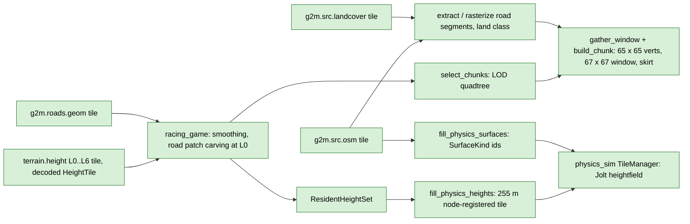

# Client-side derivations (never served)

Back to [pipeline overview](README.md). These steps run in the consumer, from tiles the server delivered. They have no layer name and no release id. They are still deterministic and tested here because the library holds the engine-neutral code.

| Step | Code | What and why |
|---|---|---|
| Decode and carve | `racing_game/core/src/world_terrain.cpp` (`fetch_and_decode`) | Raw tile, optional Gaussian smoothing (all levels), then at level 0 only a `RoadSurfacePatch` from `roads.geom` into a copy. The same tile goes to physics and render. **Lives in the game, not here.** |
| LOD selection | `include/g2m/mesh/lod_select.h`, `src/mesh/lod_select.cpp` | `LodParams` defaults: `range0_m` 250, `max_level` 6, `max_distance_m` 6000. The game sets 20000 in `world_config.json`. |
| Render chunk | `include/g2m/mesh/terrain_chunk.h` | 64 x 64 quads = 65 x 65 vertices, built from a 67 x 67 window (1 sample halo), plus a skirt (4485 vertices in all). Uses the same triangle diagonal as Jolt's heightfield so wheels sit on the drawn ground. Borders between neighbours are bit-identical. |
| Road colour and grip | `include/g2m/layer/osm_roads.h` | `extract_road_segments`, `rasterize_road_segments` (colour), `paint_road_segments` / `paint_road_blocks` (physics surface ids). Exact integer inside test; the `RoadStyle` table maps highway and surface tags to `SurfaceKind` and paved or unpaved. |
| Physics grid | `include/g2m/phys/physics_grid.h` | 255 m tiles, 256 samples at exactly 1 m, node-registered (shared border samples, even count for Jolt). Samples land on DGM1 cell centres because the session origin is a whole number of metres. One physics tile reads at most 4 data tiles. |
| Physics fill | `include/g2m/phys/fill_physics_heights.h` | Integer-offset copy, no interpolation, no allocation, no row flip. Result `Ok`, `HadNoData` or `MissingTile`. Absent (404) tiles write holes. |
| Residency, gate, prefetch | `include/g2m/phys/{resident_heights,height_tile_loader,physics_streamer}.h` | `PhysicsTerrainStreamer::update()` runs between World steps: poll loader, gate set, keep set (gate + prefetch square + look-ahead square), evict, request, ready flag. The gate depends on position and radius only. |
| Bridge | `bridges/physics_sim/include/g2m/ps_bridge/g2m_terrain_source.h` | `G2mTerrainSource` implements physics_sim's `ITerrainSource` and declares `PrefetchSupportKind::Snapshot` (`acquire_prefetch_inputs`, `fill_tile_from`, `prefetch_inputs_current`). `make_terrain_config(...)` builds the pool config. Pinned physics_sim commit: `bridges/physics_sim/physics_sim.pin`. |

Tests: `tests/mesh/test_terrain_chunk.cpp`, `test_lod_select.cpp`; `tests/phys/test_physics_grid.cpp`, `test_fill_physics_heights.cpp`, `test_fill_physics_surfaces.cpp`, `test_height_tile_loader.cpp`, `test_physics_streamer.cpp`, `test_resident_heights.cpp`; bridge tests in `bridges/physics_sim/tests/` (`test_seam_crossing`, `test_render_vs_jolt`, `test_prefetch_snapshot`, `test_determinism`, `test_residency`, `bench_bridge_fill`); goldens `g2mesh_golden.txt`, `g2paint_golden.txt`.

## physics_sim side (read-only here)

`physics_sim` `core/src/terrain/tile_manager.cpp` owns a fixed pool of Jolt heightfield bodies, a per-tile vertical datum (so Jolt's +-200 m quantisation range only covers one tile's relief), a background lane with prefetch tickets, cross-tile edge welding and hole punching under static geometry. Its own `CLAUDE.md` is the reference.
