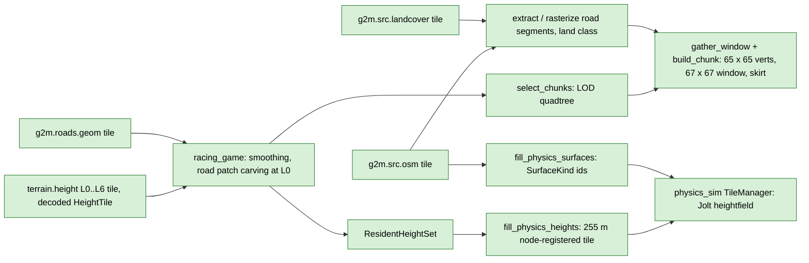

# Client-side derivations (never served)

Back to [pipeline overview](README.md). These steps run in the consumer, from tiles the server delivered. They have no layer name and no release id. They are still deterministic and tested here because the library holds the engine-neutral code.

| Step | Code | What and why |
|---|---|---|
| Decode and carve | `racing_game/core/src/world_terrain.cpp` (`fetch_and_decode`) | Raw tile, optional Gaussian smoothing (all levels), then at level 0 only a `RoadSurfacePatch` from `roads.geom` into a copy. The same tile goes to physics and render. **Lives in the game, not here.** |
| Consumer helpers (`g2m_world`) | `include/g2m/world/tile_fetch.h`, `height_sampler.h`, `chunk_road_classes.h`, `chunk_terrain_classes.h`, `surface_id_table.h`; `src/world/` | Terrain migration phase 1 (vault G2M-020): the engine-neutral parts the game's `WorldTerrain` and `route_check` hold today, moved here with bit-identical results. `decode_height_tile_container` / `fetch_height_tile_cached` (container decode, `height_offset` in int64, double-checked cache), `decode_road_segments_response` / `fetch_road_segments_cached` (Ok / Absent / Failed), `sample_height_exact` (the triangle surface Jolt and `build_chunk` share: NW-SE diagonal, a triangle is solid only if its three corners are valid) and `sample_height_bilinear` (render only, NOT the physics surface), `rasterize_chunk_road_classes` (owner rule per level-2 OSM block), `fill_chunk_terrain_classes` / `terrain_class_window` (P2 slice 11, D62: the served alternative, the render `ClassWindow` read from the `g2m.terrain.class` tile of the chunk's level, vertex = the node at floor of its position, road nodes filtered by the caller's `RenderRoadLod` on the rank plane; `ViewSource::terrain_classes` takes precedence over `class_lookup`), `SurfaceIdTable` (full `SurfaceKind` / `LandClass` to consumer ids; a road cell with a known kind takes the kind id, otherwise the land class id). `TerrainService` (below) uses them; the game has not switched yet. |
| `TerrainService` (`g2m_world`) | `include/g2m/world/terrain_service.h`, `ticket.h`, `products.h`; `src/world/terrain_service.cpp`, `job_scheduler.{h,cpp}`, `tile_cache.h` | Terrain migration phase 2 (vault G2M-020). One object opens the stores and the layer opt-ins (hence the release id), runs an in-process server and ONE worker pool, and answers every request with a `Ticket<T>` that callers only poll (`state()`/`value()` are atomic reads; nothing blocks a render or simulation thread). Requests: `height`, `terrain_class` (D62; Failed at once without the class opt-in), `road_geom`, `road_segments`, `source_osm`, `raw_tile`, plus `structures`/`road_ribbons`/`buildings` that stay Failed until a producer is installed (the payload builders `build_structure_set` / `build_road_ribbons` exist since phase 3a, see the next row; the caller installs the producer that feeds them its road geometry, or runs its own through the pool with `product<T>` + `ProductContext`). Priorities Gate > Physics > Prefetch > Render > Warm, equal priority in request order; asking for a queued tile at a higher priority raises it. A tile derives at most once at a time: concurrent requests join the running job, and the server resolver dedups the dependency tiles inside a derivation the same way (`server.h`), so two jobs needing one neighbour derive it once. A producer that needs another product joins it if running, runs it itself if only queued, and never waits for queued work, so a pool of one cannot deadlock. A ticket is one holder's interest: cancel or drop the last copy and a job that has not started never runs; a running job finishes and its result is cached. `peek_*` read the memory cache (byte-weighted LRU, `cache_bytes`) and never start work; `surface_height_exact`/`_bilinear` read resident level-0 tiles. `warm()` pre-derives a tile set into the derived store (window of tiles in flight, progress polled on the `WarmJob`, cancellable). `physics_fetch()` is an `IHeightTileFetch` for `HeightTileLoader` (blocks on the loader's own thread, the only place it may be called; Ok / NotFound / Internal, roads as a confirmed empty list outside coverage). Derived bytes and the release id are those of the plain server (tested byte for byte, goldens unchanged). Measured on the corridor store (cold derived store, the 9 level-2 `roads.geom` tiles of the start-up gate, 24-thread Ryzen 5900X, release): serial server 14.6 s, pool of 4 workers 4.4 s, 8 workers 3.0 s, 22 workers 2.8 s (the slowest single tile bounds it); `tests/world/bench_terrain_service.cpp`. |
| Structures and road ribbons (`g2m_world`) | `include/g2m/world/road_structures.h`, `road_ribbons.h`; `src/world/road_structures.cpp`, `road_ribbons.cpp` | Terrain migration phase 3a. Both are built from a `RoadGeomTile` the caller hands in (today the game's completed tile, from phase 7 the served one) and are the `StructureSet` / `RoadRibbonTile` payloads of `products.h`. `build_structure_set` / `build_road_decks`: one `RoadDeck` per bridge or tunnel stretch with a profile (a tunnel becomes a floor slab), plus a roof inferred over every tunnel that a non-structure road crosses at a higher OSM layer (client-side as-is until geo2map serves tunnel roofs, owner answer Q4); each deck carries its vertical cubics, crown, bounds and a `TerrainChunkMesh` (top, sides, bottom) the consumer installs as a physics mesh collider. With the caller's `RoadSeparation` (grade-separated crossings, default on: clearance 2.5 m, margin 3 m, reach 60 m; `enabled = false` = no approach decks) a bridge is also continued onto its ground approach as an inferred deck as far as the approach still overlaps a road more than the clearance below it, so the upper road is never carried by terrain carved for the road underneath; every deck carries its stretch's `start_ref` and a stretch only uses its own decks. `road_deck_height(deck, station, lateral)` is the crowned deck top. `build_road_ribbons(geometry, key, ground, lift, separation)`: paved stretches at 1 m stations draped on the caller's ground function (or on a deck), with lane/marking/verge flags from the served cross-section, junction patches cut on the terrain lattice (`add_junction_surfaces`), through-road overlays, stop/give-way lines, crossings, turn guides, gores and turn arrows (the full rules are in racing_game CLAUDE.md, "Junction markings"). Turn arrows read `turn:lanes` through the explicit token table of `parse_turn_token` (`road_cross_section.h`, shared with the cross-section resolver; `lane_arrow_glyphs` in `road_ribbons.h`), never as substrings of `left`/`right` (vault G2M-024): left, right and through keep their glyphs, `slight_*` and `sharp_*` get their own bent glyphs, `merge_to_left`/`merge_to_right` draw one diagonal Verschwenkungspfeil (StVO Zeichen 297.1) in the lane that ends, `none`, empty and `reverse` draw nothing, an unknown token draws nothing and is counted (`RoadRibbonTile::unknown_turn_tokens`, with `turn_arrow_lanes`/`merge_arrows`). The junction turn-guide count uses the same table (a left-only lane = left family without through/right/merge). `tools/road_census` (`g2m_road_census arrows|way`) counts the before/after effect over a stored region; `tests/world/test_road_arrows.cpp` `[arrows]`. Colours and the GPU upload stay in the consumer. Lattice drape (vault G2M-025, default `RoadRibbonOptions::drape = RibbonDrape::Lattice`; `PointSampled` is the game's old drape, kept for the 55 pins): the terrain mesh, the Jolt heightfield and `sample_height_exact` share one triangulation (1 m lattice of DGM1 cell centres, every cell split along the NW-SE diagonal), but bilinear sampling at the ribbon's vertices is not on it, and on a steep bank the terrain stood up to 0.38 m over the road (grass through the road at the B 8 / Main-Taunus-Zentrum cloverleaf: 430 of 95k probes more than 10 cm off, 222 inside the carriageway). `detail::LatticeDrape` (`src/world/lattice_drape.{h,cpp}`) reads the caller's ground function at lattice NODES only, builds the exact triangle surface from them and cuts every ribbon triangle where it crosses a lattice line or a diagonal (a triangle whose edges and interior nodes stay within `drape_tolerance_m` 8 mm of the terrain, `drape_mark_tolerance_m` 3 mm for paint, overlays and gores, is emitted whole); pieces over a terrain triangle without ground are dropped, vertices are shared by position and attributes, and the straightness decision depends on the edge alone, so tiles and neighbouring triangles never leave a crack. A bridge-end quad (deck row beside ground row) is a ramp whose pieces take max(plane, terrain) (`add_ramp`). Because it only needs node heights, a caller that feeds `sample_height_bilinear` as `ground` gets it on the next pin bump with no change of its own. Cost at the B 8 / MTZ site (16 tiles): triangles 5.58 M to 12.89 M (+131 %), vertices 5.51 M to 8.43 M (+53 %); the probe tool `g2m_ribbon_census` (`tools/ribbon_census`) prints both. Ported statement for statement from racing_game 0c027dc (approach decks from 945455a) with libm replaced by `g2m::det`; `tests/world/test_road_meshes.cpp` pins every deck byte, every deck `start_ref` and every ribbon vertex/index against the game's own output on 55 cases (three synthetic scenes - structures, junctions, a motorway overpass with a short and a long span - and every tile of both OSM fixtures, smooth and holed ground, separation off and on; `road_mesh_pins.inc`, regenerated only by `tests/world/refgen/refgen_meshes.cpp`). Merge-lane marking (vault G2M-028): at a node where the served section has a `JoinKind::Landing` join on a ramp stretch and a lane-add/drop join on the through pair, the ribbons set the broken-edge flag (64 left / 128 right) on the through carriageway's edge on the ramp's side and the hidden-edge flag (512 / 1024) on the ramp's facing edge over the landing length from the node (`tests/world/test_merge_markings.cpp`). |
| View streamer, ring streamer, buildings (`g2m_world`) | `include/g2m/world/view_streamer.h`, `ring_streamer.h`, `buildings.h`; `src/world/view_streamer.cpp`, `ring_streamer.cpp`, `buildings.cpp` | Terrain migration phase 3b. `ViewStreamer` is the render LOD around a moving focus: one background worker selects chunk keys (`select_view_keys` over `LodParams`, reselect after 128 m, less at speed via `reselect_distance_for_speed`), builds only the keys not yet resident (`build_view_chunks`, index-parallel, byte-identical for any thread count, cancellable) and hands out one `ViewDiff{added, removed, replaced}` at a time; the consumer uploads every add before it frees the removals and commits (no holes; the contract is in the header). Adds are sorted finest level first, then by time to reach (`sort_adds_by_urgency`). `set_source` applies new LOD settings: a reselect, and chunks of the levels whose road LOD key changed come back in `replaced`. A `ViewChunk` carries the mesh with its per-vertex class ids (`mesh.land_class`), its carve state (`chunk_window_carve`: NotCarved/Carved/Fallback) and its session-local origin; colours are the consumer's (`ViewSource::colour`, an optional hook run on the build thread). `RingStreamer` decides which level-2 tiles of a ring product (road ribbons, buildings) to build, show, downgrade and evict: wanted within the tier distance + 725 m, downgraded/evicted beyond it + 2048 m, jobs nearest first and tiles behind a moving focus last; it only decides, the consumer builds through `next_job()` and owns the render resources. `build_building_set` turns the buildings of one `OsmTile` into `Building`s (footprint rings, holes, heights from height / levels / roof tags, base and bottom on the caller's ground sampler); it is the `BuildingSet` payload a caller delivers with `set_buildings_producer`. `build_building_mesh` makes engine-neutral render geometry for mapped roof forms and materials, aligns `roof:direction` downhill compass angles or `roof:orientation=along/across` ridge axes, and clips pitched roof planes to concave footprints and courtyard holes while keeping mapped total height as the top bound. The tag meanings follow the [OpenStreetMap roof:direction and roof:orientation documentation](https://wiki.openstreetmap.org/wiki/Key:roof:direction). Pinned against racing_game 5a3baed: chunk bytes, keys and diffs of every streamer step (`view_pins.inc`), building bytes of synthetic scenes and every fixture tile (`building_pins.inc`), and the job order, shown/downgraded/evicted sets of road_stream.gd / building_stream.gd run headless in Godot (`ring_pins.inc`, `refgen/extract_ring_ref.sh`). |
| Routing (`g2m_route`, G4 slices 1 to 5) | `include/g2m/route/{turn_restriction,routing_graph,route_search,region_graph,route_guidance,route_map}.h`, `src/route/` | Car routing graph from the region's `roads.graph` tiles (`assemble_region_graph`: one copy per OSM id, order-independent) plus the turn restrictions the tiles carry (`roads.graph` encoding 6; `assemble_region`). Edge-based A* with ALT landmarks, heading-aware snapping, integer ms costs, via-node and via-way restrictions, oneway, access; `build_guidance` turns a route into a manoeuvre list (turns, forks, roundabout exits, ramps; names, refs, destinations, distances, lane hints from `turn:lanes`); `build_map_tile` draws minimap/full-map lines per tile at three LODs from the level-2 roads.graph tiles. Design and next slices: [../routing_design.md](../routing_design.md). |
| Transport (G6) | `include/g2m/http/http_transport.h`, `src/http/` | A consumer reaches a server through one `ITransport`: `InProcessTransport` (the game today) or `HttpTransport` (protocol v1 over HTTP to the sidecar `apps/g2m_server` or, later, a hosted server). Both give the same responses byte for byte; every fetch path that takes an `ITransport` (`TransportHeightTileFetch`, `fetch_height_tile`, `fetch_road_segments`) works over either. Binding: [../protocol/README.md](../protocol/README.md). |
| LOD selection | `include/g2m/mesh/lod_select.h`, `src/mesh/lod_select.cpp` | `LodParams` defaults: `range0_m` 250, `max_level` 6, `max_distance_m` 6000. The game sets 20000 in `world_config.json`. |
| Render chunk | `include/g2m/mesh/terrain_chunk.h` | 64 x 64 quads = 65 x 65 vertices, built from a 67 x 67 window (1 sample halo), plus a skirt (4485 vertices in all). Uses the same triangle diagonal as Jolt's heightfield so wheels sit on the drawn ground. Borders between neighbours are bit-identical. |
| Road colour and grip | `include/g2m/layer/osm_roads.h` | `extract_road_segments`, `rasterize_road_segments` (colour), `paint_road_segments` / `paint_road_blocks` (physics surface ids). Exact integer inside test; the `RoadStyle` table maps highway and surface tags to `SurfaceKind` and paved or unpaved. |
| Physics grid | `include/g2m/phys/physics_grid.h` | 255 m tiles, 256 samples at exactly 1 m, node-registered (shared border samples, even count for Jolt). Samples land on DGM1 cell centres because the session origin is a whole number of metres. One physics tile reads at most 4 data tiles. |
| Physics fill | `include/g2m/phys/fill_physics_heights.h` | Integer-offset copy, no interpolation, no allocation, no row flip. Result `Ok`, `HadNoData` or `MissingTile`. Absent (404) tiles write holes. |
| Residency, gate, prefetch | `include/g2m/phys/{resident_heights,height_tile_loader,physics_streamer}.h` | `PhysicsTerrainStreamer::update()` runs between World steps: poll loader, gate set, keep set (gate + prefetch square + look-ahead square), evict, request, ready flag. The gate depends on position and radius only. |
| Bridge | `bridges/physics_sim/include/g2m/ps_bridge/g2m_terrain_source.h` | `G2mTerrainSource` implements physics_sim's `ITerrainSource` and declares `PrefetchSupportKind::Snapshot` (`acquire_prefetch_inputs`, `fill_tile_from`, `prefetch_inputs_current`). `make_terrain_config(...)` builds the pool config. Three surface modes: one uniform id, road mode (`RoadSurfaceConfig`, OSM road raster) and class mode (`ClassSurfaceConfig{SurfaceIdTable, fallback}`, terrain migration phase 6: every cell from the `g2m.terrain.class` tile on its L0 entry through `fill_physics_classes`; the prefetch snapshot requires the class tile and compares its identity). Class-mode loading: `TransportHeightTileFetch(transport, rid, height_layer, class_layer)` plus `LoaderConfig::require_classes`; the RoadSegment metadata of a fetch stays beside the class tile (G-2). Pinned physics_sim commit: `bridges/physics_sim/physics_sim.pin`. |

Tests: `tests/mesh/test_terrain_chunk.cpp`, `test_lod_select.cpp`; `tests/world/` (`test_tile_fetch`, `test_height_sampler`, `test_chunk_road_classes`, `test_surface_id_table`; values pinned from the game code at racing_game a8a1b13; `test_terrain_service` for phase 2); `tests/server/test_server.cpp` (resolver dedup); `tests/phys/test_physics_grid.cpp`, `test_fill_physics_heights.cpp`, `test_fill_physics_surfaces.cpp`, `test_height_tile_loader.cpp`, `test_physics_streamer.cpp`, `test_resident_heights.cpp`, `test_class_mode.cpp` (class mode); bridge tests in `bridges/physics_sim/tests/` (`test_seam_crossing`, `test_render_vs_jolt` (also `sample_height_exact` vs a Jolt ray cast), `test_prefetch_snapshot`, `test_carved_prefetch` (class mode on the served carved release, prefetch hash parity), `test_determinism`, `test_residency`, `bench_bridge_fill`); goldens `g2mesh_golden.txt`, `g2paint_golden.txt`.

## physics_sim side (read-only here)

`physics_sim` `core/src/terrain/tile_manager.cpp` owns a fixed pool of Jolt heightfield bodies, a per-tile vertical datum (so Jolt's +-200 m quantisation range only covers one tile's relief), a background lane with prefetch tickets, cross-tile edge welding and hole punching under static geometry. Its own `CLAUDE.md` is the reference.
