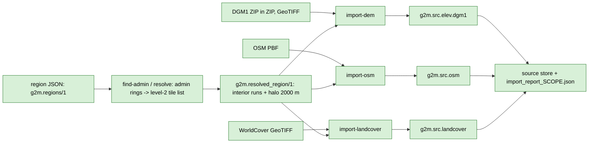

# Raw layers: import

Back to [pipeline overview](README.md).

A raw layer is imported once from a source file. It is never derived. Names start with `g2m.src.`. All raw layers live at level 2 (`kRawTileLevel`, `include/g2m/layer/layer_id.h`): 1024 m squares in UTM zone 32.

| Layer | Source | Importer | Encoding | Body content |
|---|---|---|---|---|
| `g2m.src.elev.dgm1` | HVBG DGM1 1 m GeoTIFFs, delivered as ZIP inside ZIP; optionally LGL Baden-Wuerttemberg DGM1 `.xyz` text in 2 km ZIPs (`--bw-data`, see below) | `import_dem` (`include/g2m/import/dem.h`, `src/import/`), decoders `include/g2m/decode/` | 1, [src_elev.md](../formats/src_elev.md) | 1024 x 1024 int32 heights in 1/256 m, NoData INT32_MIN, georef in the body |
| `g2m.src.osm` | Geofabrik Hessen PBF | `import_osm` (`include/g2m/import/osm.h`), clip in `include/g2m/layer/osm_clip.h` | 3, [src_osm.md](../formats/src_osm.md) | Nodes, ways, relations with ids and tags; ways complete; 128 m halo; no metadata |
| `g2m.src.landcover` | ESA WorldCover v200 | `import_landcover` (`include/g2m/import/landcover.h`) | 2, [src_landcover.md](../formats/src_landcover.md) | uint8 classes at 4 m cells, 256 x 256 samples per tile, nearest neighbour from the native 10 m; class scheme `esa_worldcover_v200` |

Facts worth knowing:

- **Quantisation.** DGM1 heights are rounded to 1/256 m with round-half-to-even (`quantise_height_half_even`). DGM1 values are already rounded decimals, so ties are common. Round trip is bit exact, NoData included.
- **Duplicate DGM1 tiles.** One 1 km tile can appear in several municipality ZIPs. Every copy is decoded and compared sample by sample. Differences are reported, not hidden.
- **Two DEM sources (Hessen + Baden-Wuerttemberg).** `import_dem` takes `DemSources{hessen, bw}` (`include/g2m/import/dem.h`; CLI `--dem-data DIR` for Hessen, `--bw-data DIR` for BW, at least one). BW is `decode/dgm1_bw.h`: ASCII `X Y Z` lines (cell centres, cm), one file per 1 km square inside `dgm1_32_<E>_<N>_2_bw.zip`, cropped at the state border, so a border file lists only the samples inside BW (a missing sample means "not BW", not NoData). Both deliveries are ETRS89/UTM32 and DHHN2016 normal heights, so no datum shift exists. A 1 km square in both sources (the Lampertheim/Viernheim border, 24 squares) is merged **per sample, never averaged**: a sample the BW file lists takes the BW height, every other sample the Hessen height. The report carries `km_bw_only`, `km_merged`, `border_samples_both`, `border_samples_differing` and `border_max_abs_diff_units` (largest seam step, 1/256 m units). Format details: `geo2map_data/SOURCES.md`.
- **Several PBFs.** `import`, `resolve` and `import-osm` take `--pbf` more than once (e.g. Hessen + Regierungsbezirk Karlsruhe). Each file is extracted for the region on its own, then merged left to right (`merge_osm_data`): OSM ids are global, so an id in both is the same object and kept once; nodes and ways take the first file's copy, a relation the one with more members (an extract clips member lists at its border), a tie the first. The merge counters are in the import report (`osm.merge_*` fields). Every way stays complete.
- **Cell registration.** DGM1 sample centres sit at half metres. Everything downstream keeps this lattice (see [terrain.md](terrain.md)).
- **Determinism of import.** Output is independent of `--jobs` and of file enumeration order. `g2m_tiler index-hash` gives a per-layer hash to check this.
- **Resolve.** `resolve` turns a region (admin boundaries from the PBF, plus a halo) into a sorted list of level-2 tiles. For the home region the halo is 2000 m. Rules: [regions.md](../formats/regions.md).
- **Home import numbers** (`import_report_home-2026-09r1.json`): 1085 resolved tiles; DEM 1000 written, 99 partial, 85 skipped (no coverage); OSM 1085; landcover 1085; 3170 tiles, 807 MB, 131 s, peak RSS 1872 MiB.
- **Tests:** `tests/unit/test_import_{dem,osm,landcover,e2e,resolve}.cpp`, `test_decode_*.cpp`, `test_dem_km_span.cpp`, `tests/layer/test_osm.cpp`, `test_region.cpp`, `test_raster_encodings.cpp`; fuzz: `tests/fuzz/*`, `tests/fuzz_formats/*`; goldens `testdata/golden/g1_golden.txt`, `g1c_golden.txt`.

Planned additions (not implemented): GLO-30 as a second elevation source (downloaded), HVBG LoD2 buildings, DOM1, DOP20, Basis-DLM, tree datasets. See [README section 5](README.md#5-data-sources).
