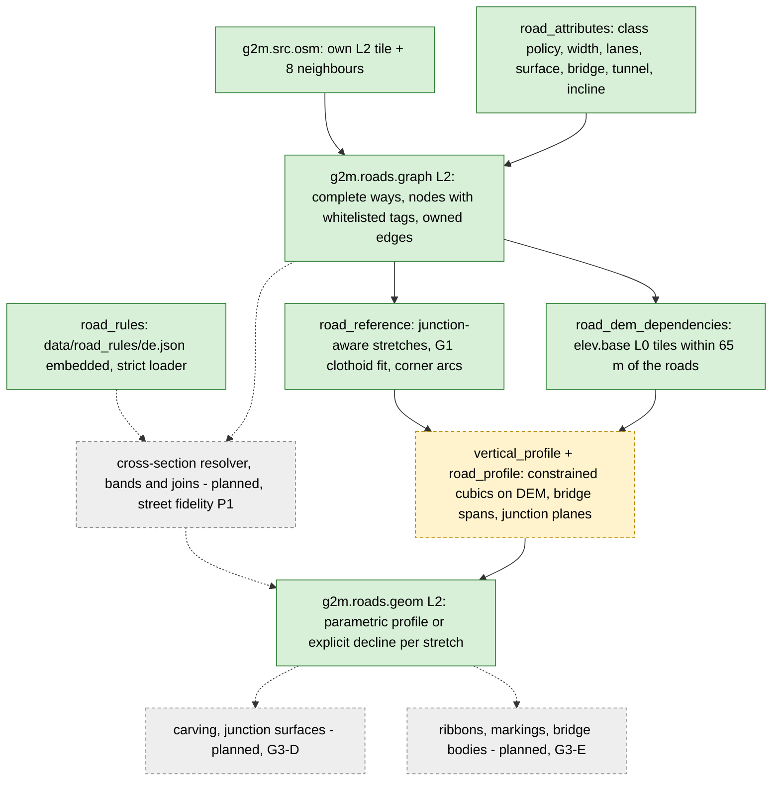

# Roads: `g2m.roads.graph` and `g2m.roads.geom`

Back to [pipeline overview](README.md). Slices and status: [../g3_road_pipeline.md](../g3_road_pipeline.md). This page only maps the pieces.

## Flow

## `g2m.roads.graph` (G3 slices A and B: implemented)

- Code: `src/layer/derive_road_graph.cpp`, `road_graph.cpp`, `road_graph_tile.cpp`, `road_attributes.cpp`, `road_rules.cpp` (street fidelity P1 country rules, `data/road_rules/de.json` embedded through CMake, `builtin_road_rules_de()`); public `include/g2m/layer/{road_graph,road_graph_tile,road_attributes,road_rules}.h`.
- Version 1, level 2, encoding 5 ([road_graph.md](../formats/road_graph.md)): nodes carry the whitelisted tags (`traffic_calming`, `crossing`, `barrier`, ...); encoding 4 without node tags still decodes.
- Needs the exact 9 neighbouring level-2 `g2m.src.osm` tiles. Absent ones are explicit empty inputs.
- Keeps every complete way that touches the tile grown by 128 m, with its original ids and tags. Connectivity comes from shared OSM node ids, never from geometric crossings.
- An edge is owned by the tile that holds its midpoint (floor-rounded integer mm). Halo copies keep the same edge identity.
- Opt-in: `BuiltinTerrainDerivers::ordered(true, ...)`; `g2m_tiler bake` turns it on when `--layers` names the layer.
- Tests: `tests/layer/test_road_graph.cpp`, `test_road_graph_tile.cpp`, `test_road_attributes.cpp`, `test_road_rules.cpp`; golden `g2roads_golden.txt` (covers the raster extraction, not the graph encoding).

## `g2m.roads.geom` (G3 slice B implemented, slice C foundation)

- Code: `src/layer/derive_road_geom.cpp`, `road_geom_tile.cpp`, `road_reference.cpp`, `road_profile.cpp`, `vertical_profile.cpp`, `road_dem_dependencies.cpp`, `road_dem_sampler.cpp`, `include/g2m/layer/road_geom_tile.h`.
- Version 1, level 2, encoding 5 ([road_geom.md](../formats/road_geom.md)). Section 1 is the unchanged graph section; section 2 holds one outcome per stretch: a parametric profile or an explicit decline with an error code and text. A tile does not promise every road is driveable.
- Inputs: the same-key `roads.graph` tile (drives coverage), the `roads.graph` tiles that hold every way incident to a node of its ways (stretch context, at most 512 tiles, absent ones skipped), and all `g2m.elev.base` level-0 tiles that the complete ways touch plus a 65 m margin.
- Stretch context (street fidelity P1 slice 1): node degrees come from the merged context graph, so stretches and profiles of a long way are identical in every tile that owns part of it (before, a node whose other ways lay outside the tile halo counted as degree 2). At a degree-two way join both stretches take one shared bisector heading (`join-bisector=1` in the config hash), so the two references have no heading kink there; stretches that fall back to the corner-arc/chord path keep their own end headings. A missing dependency, mixed datum or hash mismatch fails the whole derivation before anything is written.
- Policy fixed in the config hash text: class policy 2026-10-02, 5 m station spacing, bounded solver (2048 samples, 4096 iterations), curvature exceptions on, sloping junction planes, 32 m approach, 0.25 m bridge height correction, soft incline target.
- Tunnels return `Unsupported` (declined, not driveable in v1). Bridges use abutment interpolation; the bare-earth DEM under a bridge is never queried.
- Home-region probe (`tools/road_probe`, 2026-10-02, single run): 478 stretches in 344 ways all fit horizontally with 47 flagged curvature exceptions; vertical profiles succeed for 339; 19 tunnels unsupported, 76 curvature-bound failures, 1 over class grade, 43 solver non-convergence. Acceptance of complete profiles is **not** reached.
- Tests: `tests/layer/test_road_geom.cpp`, `test_road_reference.cpp`, `test_road_profile.cpp`, `test_vertical_profile.cpp`, `test_road_dem_*.cpp`; probe in `tools/road_probe/README.md`.

## Who uses it

`racing_game`: `core/src/world_terrain.cpp` (fetch, decode, cache of `RoadGeomTile`, carving into the level-0 height tile), `road_surface.h`, `road_visual.h`, `road_structures.h`, `npc_traffic.cpp`, `npc_truck.cpp`. `physics_sim` sees roads only as carved heights and surface ids.
`g2m_ps_bridge` has tests with roads: `bridges/physics_sim/tests/test_g2m_terrain_source_roads.cpp`, `test_render_vs_physics_roads.cpp`.

## What is still open

G3-C complete-profile acceptance; G3-D junction surfaces and server-side carving; G3-E ribbons, markings, bridge bodies; G3-F 20-junction route acceptance. Beyond G3: lane-aware cross-sections (street fidelity P1, [design](../street_fidelity/p1_cross_section_design.md)) and later P2/P3. See [README section 6](README.md#6-roadmap) and [open questions](README.md#9-open-questions-and-contradictions).
