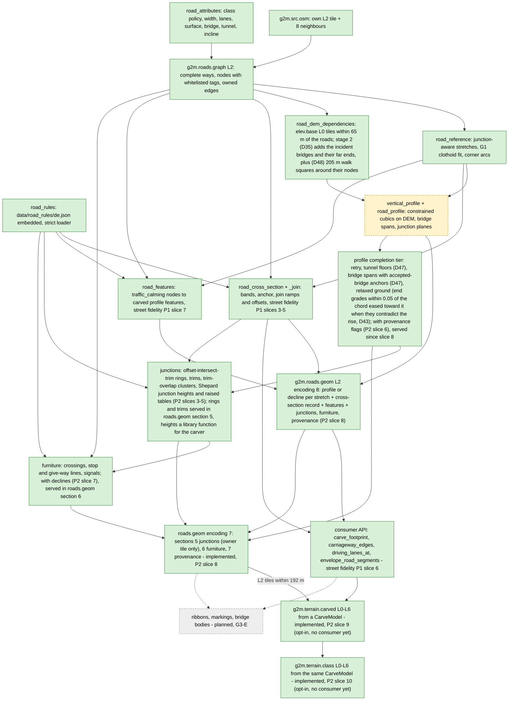

# Roads: `g2m.roads.graph` and `g2m.roads.geom`

Back to [pipeline overview](README.md). Slices and status: [../g3_road_pipeline.md](../g3_road_pipeline.md). This page only maps the pieces.

## Flow

## `g2m.roads.graph` (G3 slices A and B: implemented)

- Code: `src/layer/derive_road_graph.cpp`, `road_graph.cpp`, `road_graph_tile.cpp`, `road_attributes.cpp`, `road_rules.cpp` (street fidelity P1 country rules, `data/road_rules/de.json` embedded through CMake, `builtin_road_rules_de()`); public `include/g2m/layer/{road_graph,road_graph_tile,road_attributes,road_rules}.h`.
- Version 1, level 2, encoding 6 ([road_graph.md](../formats/road_graph.md)): nodes carry the whitelisted tags (`traffic_calming`, `crossing`, `barrier`, ...); each tile also carries the turn restrictions (`type=restriction` relations for cars) whose via node or via way it holds, read by the deriver from the nine src.osm inputs (G4 slice 3); encodings 5 (no restrictions) and 4 (no node tags either) still decode. `roads.geom` embeds encoding 5 and carries no restrictions.
- Needs the exact 9 neighbouring level-2 `g2m.src.osm` tiles. Absent ones are explicit empty inputs.
- Keeps every complete way that touches the tile grown by 128 m, with its original ids and tags. Connectivity comes from shared OSM node ids, never from geometric crossings.
- An edge is owned by the tile that holds its midpoint (floor-rounded integer mm). Halo copies keep the same edge identity.
- Opt-in: `BuiltinTerrainDerivers::ordered(true, ...)`; `g2m_tiler bake` turns it on when `--layers` names the layer.
- Tests: `tests/layer/test_road_graph.cpp`, `test_road_graph_tile.cpp`, `test_road_attributes.cpp`, `test_road_rules.cpp`; golden `g2roads_golden.txt` (covers the raster extraction, not the graph encoding).

## `g2m.roads.geom` (G3 slice B implemented, slice C foundation)

- Code: `src/layer/derive_road_geom.cpp`, `road_geom_tile.cpp`, `road_reference.cpp`, `road_profile.cpp`, `vertical_profile.cpp`, `road_dem_dependencies.cpp`, `road_dem_sampler.cpp`, `include/g2m/layer/road_geom_tile.h`.
- Version 1, level 2, encoding 8 ([road_geom.md](../formats/road_geom.md), street fidelity P2 slice 8, terrain migration phase 4: the layout of 7 plus provenance 4 TunnelFloor); encodings 7, 6 and 5 still decode. Section 1 is the roads.graph payload (encoding 5, node tags); section 2 holds one outcome per stretch (unchanged since encoding 5): a parametric profile or an explicit decline with an error code and text; section 3 one cross-section record per section-2 entry (Absent for a declined profile, a cross-section, or a whole-section decline); section 4 the profile features (not adjusted for junctions: a carver applies `adjust_features_for_junctions`); section 5 the junctions the tile owns (owner = smallest node id, half-open floor membership on integer mm), section 6 the furniture (entry items with every tile holding the entry, junction items once with their junction), section 7 one provenance record per entry. The deriver runs the completion tier with `served_road_completion_options()`. A tile does not promise every road is driveable.
- Profile features (street fidelity P1 slice 7): `resolve_profile_features` in `src/layer/road_features.cpp` reads `traffic_calming` on the interior nodes of a stretch and builds `ProfileFeature` records (kind, station, length, height, `carve`) from `de.json` defaults or `traffic_calming:length`; consumers add `feature_height_m(tile, entry, s)` to the profile (plateau + two C1 smooth-step ramps, at least 1 m ramp per side, 1:10 tables, dips negative). Vertical kinds are carved, lateral kinds (chicane, choker, island) are render only. See [road_geom.md](../formats/road_geom.md).
- Cross-sections (street fidelity P1, [design](../street_fidelity/p1_cross_section_design.md)): `resolve_cross_section` in `src/layer/road_cross_section.cpp` / `road_cross_section_join.cpp` builds lateral bands from the way tags and `de.json`, then matches lanes at degree-two way joins (width ramps, a placement-offset correction, `JoinRecord`). It reads only tags, topology, the reference length and the rules, never the DEM, so it is independent of the vertical-profile question. It runs in `build_road_geom_tile` for every stretch that has a profile. Evaluation (`boundaries_at`, `band_width_m`, `offset_m`) is allocation-free and uses only + - * /.
- Consumer API (slice 6, `include/g2m/layer/road_cross_section.h`, `road_envelope.h`; `src/layer/road_cross_section_api.cpp`, `road_envelope.cpp`): pure, allocation-free `carriageway_edges`, `carve_footprint` (carriageway, road bed without sidewalks, paved, outer edges, crown pivot and kind, kerb line and `kRoadKerbHeightM` 0.12 as data only: the kerb is a visual, physics is flush) and `driving_lanes_at` (counted lanes of a travel direction, left to right in the travel direction, lanes under 0.5 m excluded). `envelope_road_segments(tile, l0_key, spacing)` turns the same footprint into the capsule list of the grip raster: one capsule per station pair for the road bed, sidewalks as separate PavingStones capsules painted before it, verge not painted; sorted (rank, way id, sidewalk before road bed, entry, station). Edge error against the true envelope omega x spacing / 4 + omega^2 h / 2: 1.5 cm for a ramp with peak slope 1:20, 4.8 cm for the steepest shipped taper (3.5 m over 60 m). Carving, render ribbon and grip raster all call `carve_footprint`. Entries without a cross-section (declined, encoding-5 tile) emit nothing: a consumer falls back to `extract_road_segments`.
- Inputs: the same-key `roads.graph` tile (drives coverage), the `roads.graph` tiles that hold every way incident to a node of its ways (stretch context, at most 512 tiles, absent ones skipped), and all `g2m.elev.base` level-0 tiles that the complete ways touch plus a 65 m margin.
- Stretch context (street fidelity P1 slice 1): node degrees come from the merged context graph, so stretches and profiles of a long way are identical in every tile that owns part of it (before, a node whose other ways lay outside the tile halo counted as degree 2). At a degree-two way join both stretches take one shared bisector heading (`join-bisector=1` in the config hash), so the two references have no heading kink there; stretches that fall back to the corner-arc/chord path keep their own end headings. A missing dependency, mixed datum or hash mismatch fails the whole derivation before anything is written. D35 adds a second discovery stage: once the stretch-context tiles are resolved, every bridge incident to a node of the tile's ways contributes its DEM (65 m margin) and the graph tiles of its nodes, so `surface_anchor`'s read at the far end of a span is always an input (config text `bridge-far-end=1`; `IDeriver::discovery_stages`, roads.geom 2, everything else 1). D48 (terrain migration phase 5) raises the completion's abutment walk to 200 m (owner Q2; `kRoadCompletionMaxAbutmentPathM` 201.5) and has stage 2 also list the elev.base and roads.graph tiles of a 205 m square around every node of those bridges (`kRoadBridgeWalkMarginMm`, config text `bridge-walk-margin=205`), so every node and DEM cell the longer walk reads is an input; no third stage is needed (the walk starts at nodes of the stage-2 bridges). Fixture cost: +1-2 % DEM inputs, +10 % context graph tiles on hoechst_a66.
- Policy fixed in the config hash text: class policy 2026-10-02, 5 m station spacing, bounded solver (2048 samples, 4096 iterations), curvature exceptions on, sloping junction planes, 32 m approach, 0.25 m bridge height correction, soft incline target.
- Tunnels return `Unsupported` from the strict pass; since terrain migration phase 4 (D47) the completion tier gives them a `TunnelFloor` profile: the DEM along the tunnel at 5 m (30 %, 20 m radius), or, at least `tunnel_chord_min_length_m` long, one constant grade between the two portal heights (the DEM at the stretch ends; skipped when steeper than 30 %). Owner ruling 2026-10-15 (D52): long tunnels follow straight lines; the served threshold is `tunnel.straight_grade_min_length_m` in `data/road_rules/de.json`, 200 m, compared with the whole stretch's length (never a tile's part of it). Shorter tunnels and underpasses keep the DEM floor. The threshold is per stretch: a long tunnel split into several OSM ways or stretches is judged stretch by stretch, and its interior joins sit at the DEM height there. Tunnel floors are never carved and never paint grip, except the D65 cut: a tunnel stretch at most `tunnel.cut_max_length_m` (80 m) long whose DEM rises 1 to 8 m (`cut_hump_min_mm`/`cut_hump_max_mm`) above the straight chord of its portal heights is an open cut or gallery through an embankment (a road under a railway on a bank, tagged `tunnel=yes`): its floor is that chord (provenance still `TunnelFloor`, `RoadCompletionStats::tunnel_cut`) and the terrain carve cuts the bank along it unless a ground (non-tunnel, non-bridge) road crosses it in plan, which keeps the terrain under that road (`crossed_by_ground_road`) (`is_tunnel_cut` in `terrain_carve.cpp`: length within the bound and a floor straight to 1 cm). D64: a ground road under an upper bridge sees a hump in the bare-earth DEM (the deck was removed and its gap interpolated); `RoadUnderpassFinder::overpass_spans` masks it at the rim chord of the negated window (`covered`, no deck) and `overpass_end_plane` gives a stretch end inside the hump the chord's plane, so the way is no longer declined for the wall-steep DEM plane at its end node. Bridges use abutment interpolation; the bare-earth DEM under a bridge is never queried.
- Underpass decks (owner decision 2026-10-15, design D53-D58; served since roads.geom encoding 9): where a ground stretch crosses a lower road (lower OSM `layer` or tunnel, not a bridge, no shared node) in a DEM cutting, the upper profile's DEM samples over the cutting are replaced by the straight rim chord (mask), and only that span - the lower road's footprint plus the depression under the rim chord, 2 m abutments, clipped to the rims, at most 80 m, never within 1 m of a stretch end - is served as a deck (section 8: entry, start/length mm, depth, lower ways). Outside the span the road stays on the ground (same fit as before). The deriver reads the roads.graph tiles of every way crossing a tile-way segment (crossing context, not stretch context) so the spans are tile-invariant. `terrain.carved` leaves the deck span to the lower road (no slot, and the cutting's walls stay steep: the upper road's blend fades out within 1 m past the deck ends, D59), the road envelope paints no grip there, and `g2m::world::build_road_decks` emits an inferred deck for it (and no inferred tunnel roof on top). Parameters and the switch: the `underpass` block of `data/road_rules/de.json` (kept as served by the owner's decision, D60). Tag rules (D61, owner answers on the real crossings): a parking-structure storey (`service=parking_aisle` or any `level=*`) is neither an upper nor a lower road; a span whose lower ways are all tunnels is masked but not served as a deck (the road stays on the ground over the tunnel).
- Home-region probe (`tools/road_probe`, 2026-10-02, single run): 478 stretches in 344 ways all fit horizontally with 47 flagged curvature exceptions; vertical profiles succeed for 339; 19 tunnels unsupported, 76 curvature-bound failures, 1 over class grade, 43 solver non-convergence. Acceptance of complete profiles is **not** reached.
- Tests: `tests/layer/test_road_geom.cpp`, `test_road_geom_xs.cpp` (encoding 6 and 7 round trips, one rejection test per validation rule of design 7.2, encoding-5 compatibility, config hash and release id), `test_road_geom_enc7.cpp` (T8: one rejection per junction/furniture/provenance rule of P2 design 9.2 with its own malformed body; T7: every junction owned exactly once and equal to every other tile's build, entry furniture identical across tiles, with the tile-graph negative control), `test_road_cross_section.cpp`, `test_road_joins.cpp`, `test_road_features.cpp`, `test_road_api.cpp` (footprint, lane queries, zero allocations, painted envelope against the carve footprint on a 0.25 m lattice and over real Hoechst A 66 stretches, edge error at tapers, F8 lane order), `test_road_reference.cpp`, `test_road_profile.cpp`, `test_vertical_profile.cpp`, `test_road_dem_*.cpp`; probe in `tools/road_probe/README.md`.

## Junctions, furniture (served) and carving (terrain.carved and terrain.class served) - street fidelity P2 = G3-D

Design: [../street_fidelity/p2_junction_design.md](../street_fidelity/p2_junction_design.md) (12 slices, section 14). Status: slices 1-9 (rules data, `road_surface_height_m`, per-node junction rings and trims, clusters, junction heights and raised tables, the profile completion tier, junction furniture, roads.geom encoding 7, the `g2m.terrain.carved` layer) implemented; slice 10 (`g2m.terrain.class`, [format](../formats/terrain_class.md)) implemented and the physics class mode of slice 11 wired (terrain migration phase 6); slice 11's render class window, slice 12's home census (the G-6 underpass census `road_underpass_census` / `g2m_road_probe --underpasses` exists) and the consumer switch open. Slice 8 serves the junction rings and trims, the furniture and the completion tier with its provenance in roads.geom encoding 7 (`build_road_geom_tile` stores only the junctions whose owner node lies in the tile; validation of design 9.2 in `encode_road_geom`/`decode_road_geom`); junction heights stay a library function for the carver. Implemented before slice 8: Implemented so far: the furniture builder `build_road_furniture` (`road_furniture.h`: crossings with pattern, length and flags, stop and give-way lines spanning exactly the lanes of the controlled direction, signal posts at the travel-right edge + 0.5 m, one record per source node and item with its own decline reason, entry furniture owned by one entry chosen from the context graph so tiles agree, `furniture_quad` and `signal_post`; library functions, no served bytes); the completion tier `complete_road_profiles` (`road_completion.h`: opt-in retry, bridge and ground re-fits of strict declines, every added profile flagged by `ProfileProvenance`, anchors a pure function of the node so tiles agree; tile bytes unchanged until encoding 7); `make_junction_surface` / `junction_height_m` (Shepard blend of the approach surfaces by the product form of inverse squared distances to the trim segments, exact on every trim line, plus table and hump ramps over the carriageway and the suppression of approach features inside a ring: `adjust_features_for_junctions`; library functions, no served bytes); `build_node_junction` and `build_road_junctions` (`road_junction.h`, offset-intersect-trim rings with corner caps and circular kerb returns on block corners (D44, radii per class in `de.json`), trims, bow-tie repair, convex-hull fallback on all three layers, declines; trim-overlap clusters with one ring around the cluster by a boundary walk, `ClusterTooLarge` records, tile-invariant discovery that skips what a tile cannot resolve; library functions, no stage or served bytes yet); `road_surface_height_m` (`road_surface.h`, the canonical road height of design 4.1, a pure library function over a `RoadGeomTile` entry); the `junction` and `furniture` blocks of `de.json` (loader only, `JunctionRules`/`FurnitureRules`), `data/carve/carve_default.json` (`carve_params.h`) and `data/classifiers/esa_worldcover_v200.json` (`landcover_classifier.h`); the surface function is a library function only.

- **Junctions:**
  - nodes of degree ≥ 3 in the merged context graph;
  - clusters only where the approach trims overlap (caps 48 m, 12 nodes; the PLAN's 25 m rule chains up to 17 nodes and 106 m on the fixtures);
  - rings (road bed, paved, outer) by the osm2streets offset-intersect-trim algorithm, ported to integer-mm P1 edge polylines with exact predicates;
  - heights: an inverse-squared-distance blend of the approaches' own surfaces, exact on every trim line.
  Each junction is stored once, in the `roads.geom` tile that holds its smallest node id.
- **Profile completion tier:** racing_game's `complete_road_profiles` and its 20 m retry move into `build_road_geom_tile`, flagged per entry.
- **Furniture:** crossing quads with pattern; stop and give-way lines over exactly the approach-direction driving lanes, 1 m before a crossing; signal posts and facing. Each source node gets a placed record or a decline reason.
- **roads.geom encoding 7 (implemented, slice 8):**
  - sections 5 (junctions), 6 (furniture), 7 (provenance);
  - sections 1-4 keep their format;
  - new rule blocks `junction` and `furniture` in `de.json`.
- **Carving** (new layers; `g2m.terrain.height` stays the bare default):
  - `g2m.terrain.carved` L0-L6 (implemented, slice 9; [format](../formats/terrain_carved.md), `src/layer/terrain_carve.cpp`, opt-in through `BuiltinTerrainDerivers::ordered(..., include_carved)`, no consumer yet): the game's smoothing ported as an integer kernel, then road cores, junctions, blends and the deck clearance clamp; L1-L6 are the mean-of-4 of the carved L0. Bridges, tunnels and `OnStructure` junctions are not carved. Tests `tests/layer/test_terrain_carve.cpp`, golden `g3d_golden.txt`;
  - `g2m.terrain.class` L0-L6 (implemented, slice 10; [format](../formats/terrain_class.md), `src/layer/terrain_class.cpp`, opt-in through `ordered(..., include_classes)`, no consumer yet): node-registered 257 x 257 at integer metres, the physics cell centres; land class, surface, role and rank from the same ownership function; L1-L6 rank-max. Tests `tests/layer/test_terrain_class.cpp`, golden `g3c_golden.txt`;
  - Inputs of a carved L0 tile: its 3 x 3 `elev.base` neighbourhood and every `roads.geom` tile within 192 m.
  - Carving parameters live in `data/carve/carve_default.json`, so re-tuning them does not re-derive `roads.geom`.
- **Consumer switch:** racing_game then deletes its smoothing, `RoadSurfacePatch` carving, deck clearance cut, profile completion and src.osm road raster, with no fallback ([design section 10](../street_fidelity/p2_junction_design.md#10-consumer-switch-what-racing_game-needs-and-deletes)).

## Who uses it

`racing_game`: `core/src/world_terrain.cpp` (fetch, decode, cache of `RoadGeomTile`, carving into the level-0 height tile), `road_surface.h`, `road_visual.h`, `road_structures.h`, `npc_traffic.cpp`, `npc_truck.cpp`. `physics_sim` sees roads only as carved heights and surface ids.
`g2m_ps_bridge` has tests with roads: `bridges/physics_sim/tests/test_g2m_terrain_source_roads.cpp`, `test_render_vs_physics_roads.cpp`.

## What is still open

G3-C complete-profile acceptance; G3-D junction surfaces and server-side carving (designed as street fidelity P2, [design](../street_fidelity/p2_junction_design.md); slices 1-9 implemented, junctions, furniture and completion served in roads.geom encoding 7 since slice 8, carved terrain served as `g2m.terrain.carved` since slice 9, `g2m.terrain.class` since slice 10; the consumer switch open); G3-E ribbons, markings, bridge bodies; G3-F 20-junction route acceptance. Street fidelity P1 (lane-aware cross-sections, [design](../street_fidelity/p1_cross_section_design.md)) slices 1-7 are implemented; P3 markings follow P2. See [README section 6](README.md#6-roadmap) and [open questions](README.md#9-open-questions-and-contradictions).
