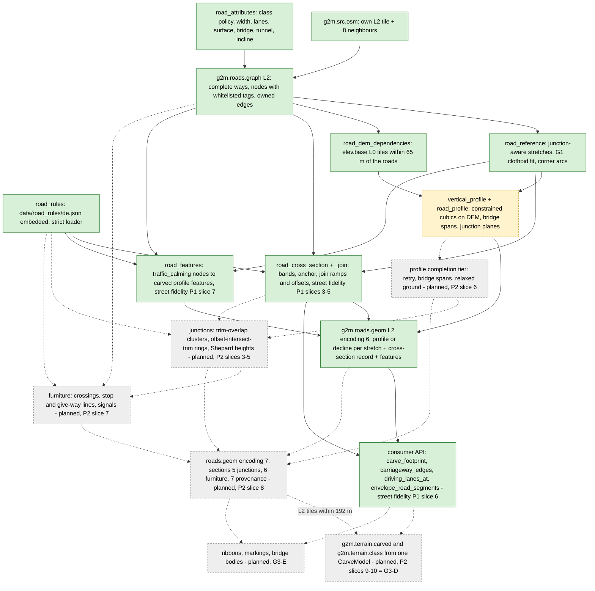

# Roads: `g2m.roads.graph` and `g2m.roads.geom`

Back to [pipeline overview](README.md). Slices and status: [../g3_road_pipeline.md](../g3_road_pipeline.md). This page only maps the pieces.

## Flow

## `g2m.roads.graph` (G3 slices A and B: implemented)

- Code: `src/layer/derive_road_graph.cpp`, `road_graph.cpp`, `road_graph_tile.cpp`, `road_attributes.cpp`, `road_rules.cpp` (street fidelity P1 country rules, `data/road_rules/de.json` embedded through CMake, `builtin_road_rules_de()`); public `include/g2m/layer/{road_graph,road_graph_tile,road_attributes,road_rules}.h`.
- Version 1, level 2, encoding 5 ([road_graph.md](../formats/road_graph.md)): nodes carry the whitelisted tags (`traffic_calming`, `crossing`, `barrier`, ...); encoding 4 without node tags still decodes.
- Needs the exact 9 neighbouring level-2 `g2m.src.osm` tiles. Absent ones are explicit empty inputs.
- Keeps every complete way that touches the tile grown by 128 m, with its original ids and tags. Connectivity comes from shared OSM node ids, never from geometric crossings.
- An edge is owned by the tile that holds its midpoint (floor-rounded integer mm). Halo copies keep the same edge identity.
- Opt-in: `BuiltinTerrainDerivers::ordered(true, ...)`; `g2m_tiler bake` turns it on when `--layers` names the layer.
- Tests: `tests/layer/test_road_graph.cpp`, `test_road_graph_tile.cpp`, `test_road_attributes.cpp`, `test_road_rules.cpp`; golden `g2roads_golden.txt` (covers the raster extraction, not the graph encoding).

## `g2m.roads.geom` (G3 slice B implemented, slice C foundation)

- Code: `src/layer/derive_road_geom.cpp`, `road_geom_tile.cpp`, `road_reference.cpp`, `road_profile.cpp`, `vertical_profile.cpp`, `road_dem_dependencies.cpp`, `road_dem_sampler.cpp`, `include/g2m/layer/road_geom_tile.h`.
- Version 1, level 2, encoding 6 ([road_geom.md](../formats/road_geom.md)); encoding 5 still decodes. Section 1 is the roads.graph payload (encoding 5, node tags); section 2 holds one outcome per stretch (unchanged since encoding 5): a parametric profile or an explicit decline with an error code and text; section 3 one cross-section record per section-2 entry (Absent for a declined profile, a cross-section, or a whole-section decline); section 4 the profile features. A tile does not promise every road is driveable.
- Profile features (street fidelity P1 slice 7): `resolve_profile_features` in `src/layer/road_features.cpp` reads `traffic_calming` on the interior nodes of a stretch and builds `ProfileFeature` records (kind, station, length, height, `carve`) from `de.json` defaults or `traffic_calming:length`; consumers add `feature_height_m(tile, entry, s)` to the profile (plateau + two C1 smooth-step ramps, at least 1 m ramp per side, 1:10 tables, dips negative). Vertical kinds are carved, lateral kinds (chicane, choker, island) are render only. See [road_geom.md](../formats/road_geom.md).
- Cross-sections (street fidelity P1, [design](../street_fidelity/p1_cross_section_design.md)): `resolve_cross_section` in `src/layer/road_cross_section.cpp` / `road_cross_section_join.cpp` builds lateral bands from the way tags and `de.json`, then matches lanes at degree-two way joins (width ramps, a placement-offset correction, `JoinRecord`). It reads only tags, topology, the reference length and the rules, never the DEM, so it is independent of the vertical-profile question. It runs in `build_road_geom_tile` for every stretch that has a profile. Evaluation (`boundaries_at`, `band_width_m`, `offset_m`) is allocation-free and uses only + - * /.
- Consumer API (slice 6, `include/g2m/layer/road_cross_section.h`, `road_envelope.h`; `src/layer/road_cross_section_api.cpp`, `road_envelope.cpp`): pure, allocation-free `carriageway_edges`, `carve_footprint` (carriageway, road bed without sidewalks, paved, outer edges, crown pivot and kind, kerb line and `kRoadKerbHeightM` 0.12 as data only: the kerb is a visual, physics is flush) and `driving_lanes_at` (counted lanes of a travel direction, left to right in the travel direction, lanes under 0.5 m excluded). `envelope_road_segments(tile, l0_key, spacing)` turns the same footprint into the capsule list of the grip raster: one capsule per station pair for the road bed, sidewalks as separate PavingStones capsules painted before it, verge not painted; sorted (rank, way id, sidewalk before road bed, entry, station). Edge error against the true envelope omega x spacing / 4 + omega^2 h / 2: 1.5 cm for a ramp with peak slope 1:20, 4.8 cm for the steepest shipped taper (3.5 m over 60 m). Carving, render ribbon and grip raster all call `carve_footprint`. Entries without a cross-section (declined, encoding-5 tile) emit nothing: a consumer falls back to `extract_road_segments`.
- Inputs: the same-key `roads.graph` tile (drives coverage), the `roads.graph` tiles that hold every way incident to a node of its ways (stretch context, at most 512 tiles, absent ones skipped), and all `g2m.elev.base` level-0 tiles that the complete ways touch plus a 65 m margin.
- Stretch context (street fidelity P1 slice 1): node degrees come from the merged context graph, so stretches and profiles of a long way are identical in every tile that owns part of it (before, a node whose other ways lay outside the tile halo counted as degree 2). At a degree-two way join both stretches take one shared bisector heading (`join-bisector=1` in the config hash), so the two references have no heading kink there; stretches that fall back to the corner-arc/chord path keep their own end headings. A missing dependency, mixed datum or hash mismatch fails the whole derivation before anything is written.
- Policy fixed in the config hash text: class policy 2026-10-02, 5 m station spacing, bounded solver (2048 samples, 4096 iterations), curvature exceptions on, sloping junction planes, 32 m approach, 0.25 m bridge height correction, soft incline target.
- Tunnels return `Unsupported` (declined, not driveable in v1). Bridges use abutment interpolation; the bare-earth DEM under a bridge is never queried.
- Home-region probe (`tools/road_probe`, 2026-10-02, single run): 478 stretches in 344 ways all fit horizontally with 47 flagged curvature exceptions; vertical profiles succeed for 339; 19 tunnels unsupported, 76 curvature-bound failures, 1 over class grade, 43 solver non-convergence. Acceptance of complete profiles is **not** reached.
- Tests: `tests/layer/test_road_geom.cpp`, `test_road_geom_xs.cpp` (encoding 6, one rejection test per validation rule of design 7.2, encoding-5 compatibility, config hash and release id), `test_road_cross_section.cpp`, `test_road_joins.cpp`, `test_road_features.cpp`, `test_road_api.cpp` (footprint, lane queries, zero allocations, painted envelope against the carve footprint on a 0.25 m lattice and over real Hoechst A 66 stretches, edge error at tapers, F8 lane order), `test_road_reference.cpp`, `test_road_profile.cpp`, `test_vertical_profile.cpp`, `test_road_dem_*.cpp`; probe in `tools/road_probe/README.md`.

## Planned: junctions, carving, furniture (street fidelity P2 = G3-D)

Design only, nothing implemented: [../street_fidelity/p2_junction_design.md](../street_fidelity/p2_junction_design.md) (12 slices, section 14).

- **Junctions:**
  - nodes of degree ≥ 3 in the merged context graph;
  - clusters only where the approach trims overlap (caps 48 m, 12 nodes; the PLAN's 25 m rule chains up to 17 nodes and 106 m on the fixtures);
  - rings (road bed, paved, outer) by the osm2streets offset-intersect-trim algorithm, ported to integer-mm P1 edge polylines with exact predicates;
  - heights: an inverse-squared-distance blend of the approaches' own surfaces, exact on every trim line.
  Each junction is stored once, in the `roads.geom` tile that holds its smallest node id.
- **Profile completion tier:** racing_game's `complete_road_profiles` and its 20 m retry move into `build_road_geom_tile`, flagged per entry.
- **Furniture:** crossing quads with pattern; stop and give-way lines over exactly the approach-direction driving lanes, 1 m before a crossing; signal posts and facing. Each source node gets a placed record or a decline reason.
- **roads.geom encoding 7:**
  - sections 5 (junctions), 6 (furniture), 7 (provenance);
  - sections 1-4 keep their format;
  - new rule blocks `junction` and `furniture` in `de.json`.
- **Carving** (new layers; `g2m.terrain.height` stays the bare default):
  - `g2m.terrain.carved` L0-L6: the game's smoothing ported as an integer kernel, then road cores, junctions, blends and the deck clearance clamp; L1-L6 are the mean-of-4 of the carved L0;
  - `g2m.terrain.class` L0-L6: node-registered 257 x 257 at integer metres, the physics cell centres; land class, surface, role and rank from the same ownership function.
  - Inputs of a carved L0 tile: its 3 x 3 `elev.base` neighbourhood and every `roads.geom` tile within 192 m.
  - Carving parameters live in `data/carve/carve_default.json`, so re-tuning them does not re-derive `roads.geom`.
- **Consumer switch:** racing_game then deletes its smoothing, `RoadSurfacePatch` carving, deck clearance cut, profile completion and src.osm road raster, with no fallback ([design section 10](../street_fidelity/p2_junction_design.md#10-consumer-switch-what-racing_game-needs-and-deletes)).

## Who uses it

`racing_game`: `core/src/world_terrain.cpp` (fetch, decode, cache of `RoadGeomTile`, carving into the level-0 height tile), `road_surface.h`, `road_visual.h`, `road_structures.h`, `npc_traffic.cpp`, `npc_truck.cpp`. `physics_sim` sees roads only as carved heights and surface ids.
`g2m_ps_bridge` has tests with roads: `bridges/physics_sim/tests/test_g2m_terrain_source_roads.cpp`, `test_render_vs_physics_roads.cpp`.

## What is still open

G3-C complete-profile acceptance; G3-D junction surfaces and server-side carving (designed as street fidelity P2, [design](../street_fidelity/p2_junction_design.md), not implemented); G3-E ribbons, markings, bridge bodies; G3-F 20-junction route acceptance. Street fidelity P1 (lane-aware cross-sections, [design](../street_fidelity/p1_cross_section_design.md)) slices 1-7 are implemented; P3 markings follow P2. See [README section 6](README.md#6-roadmap) and [open questions](README.md#9-open-questions-and-contradictions).
