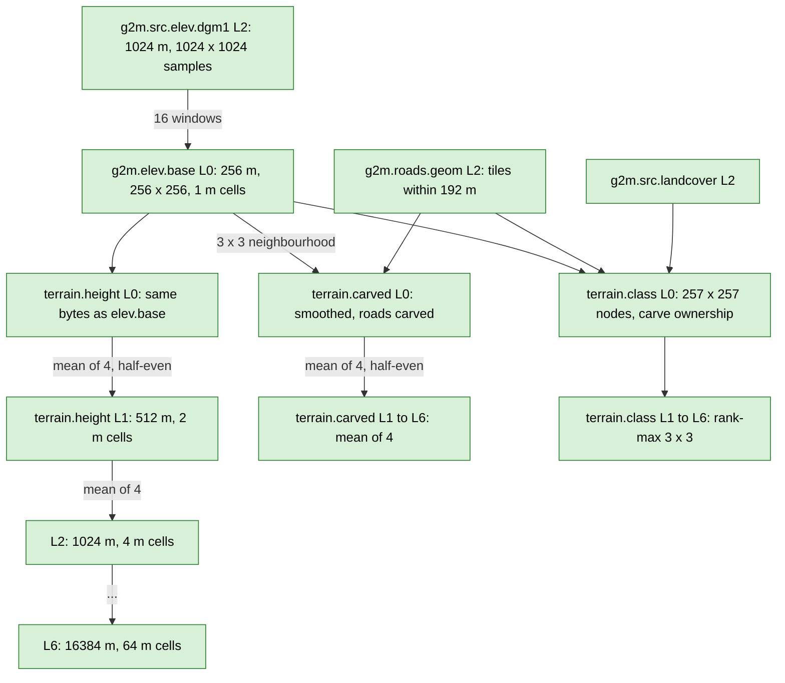

# Terrain heights

Back to [pipeline overview](README.md). Code: `include/g2m/layer/{terrain_layers,derive_terrain,height_tile}.h`, `src/layer/{terrain_layers,derive_terrain,height_tile}.cpp`.

## Layers

| Layer | Version | Levels | Encoding | Input | Config hash text |
|---|---|---|---|---|---|
| `g2m.elev.base` | 1 | 0 | 1 (SrcElev) | `g2m.src.elev.dgm1` (the one level-2 ancestor tile) | `g2m.elev.base/1 dgm1-only` |
| `g2m.terrain.height` | 1 | 0 to 6 | 1 (SrcElev) | L0: `g2m.elev.base` same key. L1 to L6: the 4 children of the same layer one level down | `g2m.terrain.height/2 L0-passthrough-of-elev.base; L1-L6 mean-of-4 half-even pyramid` |
| `g2m.terrain.carved` | 1 | 0 to 6 | 1 (SrcElev) | L0: `g2m.elev.base` 3 x 3 neighbourhood + `g2m.roads.geom` L2 tiles within 192 m. L1 to L6: the 4 children of the same layer | `g2m.terrain.carved/1 smooth+carve L0 roads.geom enc=8 radius=192 junction=D42 carve=<sha256>; L1-L6 mean-of-4 half-even` ([format](../formats/terrain_carved.md)) |
| `g2m.terrain.class` | 1 | 0 to 6 | 7 (TerrainClass) | L0: the carved L0 inputs + `g2m.src.landcover` L2 tiles holding any of its nodes. L1 to L6: the 4 x 4 same-layer tiles of level L-1 around the children (D49) | `g2m.terrain.class/1 nodes=257 L0 carve-ownership ...; L1-L6 rank-max 3x3 centre-then-row-major window=4x4` ([format](../formats/terrain_class.md)) |

## Lattice and units

- Every terrain tile has 256 x 256 samples, **cell-registered** (sample at the cell centre) and **row 0 = south** (`HeightTile`, `height_tile.h`). Sample (i, j) of tile `key` is at `(min_easting + (i + 0.5) * 2^level, min_northing + (j + 0.5) * 2^level)`.
- Heights: int32, 1/256 m. NoData = `kHeightNoData` = INT32_MIN. A tile header can carry a `height_offset` that the reader adds to every non-NoData sample (racing_game decodes it that way).
- Datum: DHHN2016 normal heights (as delivered by DGM1).
- Downsampling: mean of 4, half-to-even rounding. A child that is missing (no coverage) counts as all NoData. An output sample is NoData if any of its 4 source samples is NoData (`downsample_2x2()`, `height_tile.h`).

## What is NOT here

- No road carving in `terrain.height`: it serves raw DGM1 heights. The carved heights are the separate opt-in layer `g2m.terrain.carved` (street fidelity P2 slice 9; section 2.4 of the [overview](README.md), [format](../formats/terrain_carved.md)), which no consumer reads yet.
- No blending with other elevation sources, no halo. (PLAN.md 6.1 describes both; the code does not.)
- `terrain.class` tiles exist (opt-in, [format](../formats/terrain_class.md)) but no consumer reads them yet: land colour and grip in the game still come from `g2m.src.landcover` and `g2m.src.osm` directly, see [client_side.md](client_side.md). The physics bridge can already fill from them (class mode).

## Consumers

1. `racing_game` `rg::WorldTerrain` (`core/src/world_terrain.cpp`) fetches `g2m.terrain.height` tiles, decodes them, optionally smooths (all levels), and at level 0 carves a road patch from `g2m.roads.geom`. The result feeds both render chunks and physics.
2. `g2m_ps_bridge` (`bridges/physics_sim`) exposes the same tiles to `physics_sim` as an `ITerrainSource` ([client_side.md](client_side.md)).

## Tests and goldens

`tests/layer/test_derive_terrain.cpp`, `test_terrain_pyramid.cpp`; goldens `testdata/golden/g2_golden.txt`; carved layer: `tests/layer/test_terrain_carve.cpp`, golden `g3d_golden.txt`; mesh and physics seam tests in [client_side.md](client_side.md). Acceptance in `racing_game/PLAN.md` G2: heights equal DGM1 within 1/256 m, chunk borders bit-identical, `fill_tile` allocation-free and worker-count invariant.
